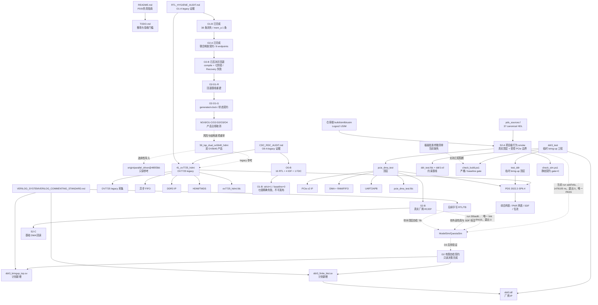

> generated_by: Codex manual bootstrap
> verified_at: 2026-09-01
> provenance: manual inspection of current source tree and PDS artifacts

# Dependencies

## 关键依赖约束

- 摄像头产品固定双 OV5640，参考为只读 `origin/parallel_driver@485f3bb`。参考顶层 `top_dual_ov5640_hdmi` 依赖两路独立 SCCB/RESET/PWDN/DVP、每路 960x1080 半幅、双写 DDR3 和 1920x1080 组合输出。
- 参考根 PDS/DDR3 依赖 PG2L100H，仅 PCIe IP 为 PG2L50H；实际产品必须在 `59_top_dual_ov5640_hdmi/` 独立建立 PG2L50H PDS/DDR3 证据，不能继承参考工程器件结论。
- 参考仓库 4 个 TB 尚未导入；`tb_dual_ov5640_dri.v` 通过 force `cam_init_done` 绕过初始化，且成功字符串不是 canonical `TEST PASS`，必须选择性审核和改造。
- 双 OV5640 可复现仿真源只依赖 `59_top_dual_ov5640_hdmi/sim/questa/`，运行态只依赖该工程 `build/`；禁止导入 `sim_*`、`work`、`.mpf`、`modelsim.ini`、日志、波形、绝对路径生成物或许可证配置。`41_ov7725_hdmi/sim/questa/` 仅 legacy。
- 厂商 `.idf`、生成 RTL 和 PDS 仿真库属于外部生成依赖，不应被误当作独立手写逻辑。
- PCIe S2-A 的 `sim/questa/behav.f` 依赖 37 个实现侧 canonical HDL、仿真专用补充源、DMA RAM init include、reset helper、项目 TB 与受控边界模型。当前 Questa run `add7efa39f644384af9929e8a9366739` 运行至 `1476105 ns`，以唯一 `TEST PASS` 通过（0 errors/0 warnings、退出 0）；S2-A/S2-B 静态门禁通过。
- 每次 S2-A 动态运行按 `SIM_RUN_ID` 创建独立 `build/sim/behav/<run_id>/work`，避免上一次编译的 work library 被误用；日志身份、work 隔离和公共 USIM 是三个不同依赖，均不能由单独一个 `TEST PASS` 替代。
- 三个项目的可复现 Questa 工程分别位于各自工程内独立 `sim/questa/`；work/vendor library、日志、transcript、波形与 ini 等运行态只进入对应 `build/`，不与工程定义混放。
- S2-B 每次运行同时创建 run-scoped `work` 与物理 vendor library，厂商模型必须直接编译到该物理目录；TB 的 `GTP_GRS GRS_INST` 为 `GRS_INST.GRSNET` 层级依赖，项目源的 `1ns/10ps` 和 DO transcript `echo` 为厂商兼容与日志身份依赖。
- S2-A 的受控 link indication 只驱动顶层复位、LED 和未知态检查，不能替代 S2-B 的真实厂商 RC/EP、LTSSM/TLP，也不能替代 S2-C 的 DMA 数据回读。S2-B 首次 L0 后允许 RC 合法进入 `0x0d` Recovery/速率重训练，在 6 ms 总窗口内寻找连续 32 周期双端 link-up/L0，任何中断将计数归零；run `30bad6e164be4a4b8284a00f1e96bd87` 输出唯一 link-up marker 和唯一 `TEST PASS`，Errors 0、Warnings 26、PowerShell 退出 0。最新 S2-A/S2-B 运行后项目根 `modelsim.ini`、transcript、`vsim.wlf` 计数均为 0。`SIM_RUN_ID` 与唯一 `TEST PASS` 只绑定一次仿真日志，不扩张到 DMA、RK3568 实板、协商 x2/5.0 GT/s、电气或后级网表。
- OV7725 O0-A 已识别 `sys_clk`、`i2c_dri_clk`、`cam_pclk`、`pixel_clk`、`pixel_clk_5x`、`clk_50m/ref_clk` 和 `ui_clk`；证据入口为 `41_ov7725_hdmi/doc/CDC_RDC_AUDIT.md`。
- `wr_load` 与 `rd_load` 当前被多个逻辑独立采样；write FIFO 数据方向为 `cam_pclk → ui_clk`，read FIFO 为 `ui_clk → pixel_clk`，两者均需把复位分别在读写时钟域同步释放。
- OV7725 O1-B 已固定 16 个手写 RTL、4 个活动 IDF 和唯一顶层 FDC，从空 `build/` 完成 SP6.4 七阶段，进程退出 0、日志 `E: 0`、warning `4067`、critical `81`，并生成非零综合网表、PNR 网表、SDF、`.sbit` 和 `.bin`。
- OV7725 O1-B 已消除 38 条确定性手写 RTL 位宽告警，只剩精确的 `ddr3_ip.mem_a` 1 条；严格 gate 返回 1，baseline 仅在七组 corner/check/clock pair/endpoints 精确匹配时返回 0，且继续标记不可发布。
- 高有效 reset 已驱动四个 serializer 内的八个 OSERDES。O2-B 曾按 O2-A 契约级联 `pixel_clk_5x` 两级释放并完成 compile/七阶段，但 Slow Recovery 出现 `pixel_clk_5x → pixel_clk_5x -0.349 ns / 8/8` 与 `pixel_clk_5x → pixel_clk -2.173 ns / 8/8`，Fast Recovery 反向组仍为 `-1.464 ns / 8/8`；八个反向 endpoint 正是四个 serializer 的 master/slave OSERDES `OCLKDIV` 检查。
- O2-B 已触发停止条件并完整回退；`check_build.ps1`、旧七组 baseline、FDC/RCF、PLL/IP 和时序例外均未修改。O2-D1 已否决动态门控，O2-D1-G 进一步冻结唯一候选：`CLKOUT3=65.0026 MHz`、约 `+0.192 ns` 相位、每 serializer 本地 reset 复制，以及唯一 `/5` generated-clock（`u_pll_clk/clkout1` → 唯一 `GTP_IOCLKDIV_E2.CLKDIVOUT`，`-edges {1 5 11}`）。
- `mem_a` 不属于 O1-B：活动 IP 是 14 bit，顶层/FDC 是 15 bit，综合网表把第 15 bit 绑 0。该冲突冻结为 OV7725 legacy 风险，不再修改旧 RTL/FDC/IP；双 OV5640 的 DDR3 地址组织必须在新项目依据一手板级资料重新建立。
- OV7725 O2-D1-R、O2-D1-G 与 M3-A 均为旧 PG2L100H 历史证据。owner 已取消 M3-B、O1-C、O2-D2、O2-C1/C2、O3 与 O4；不得再为旧工程重生成 PG2L50H IP、修改功能 RTL/约束或生成产品位流。
- 双 OV5640 C2/C3 可逐项参考旧 generated-clock、端点覆盖、CDC/RDC、FIFO reset 与 IP 版本断层风险，但必须在 `59_top_dual_ov5640_hdmi/` 独立设计、生成和验证，不继承旧参数、对象或 baseline。
- DDR3 新入口已用 `test_ddr`、`ddr3.idf`、FDC 和 RCF 从空 `build/` 完成七阶段全流程，内部 STA 为 `All Constraints Met`，且综合网表、PNR 网表、SDF 和位流均非零。
- DDR3 M2 只读审计（2026-08-30）确认：活动 `ddr3_test/ddr3_test/ip_core/ddr3/ddr3.idf` metadata 为 `Logos2/PG2L100H/FBG484/-6`，生成器为 `2022.2-SP6.4`；canonical 约束是 `ip_core/ddr3/pnr/ddr_test.fdc` 与 `ip_core/ddr3/pnr/ddr3.rcf`。外层 `ip_core/ddr_test.fdc` 仅作为旧硬宏位置参考，不得覆盖 canonical 约束。
- DDR3 现存 `ip_backup/20250108100125/ddr3/ddr3.idf` 虽标识 `Logos2/PG2L50H/FBG484/-6`，但由 `2022.2-SP6.1` 生成；它只能用于参数/器件差异比对，不能直接恢复、复制或作为 SP6.4 发布输入。M2 必须在 SP6.4 中重新生成 controller、PHY、wrapper、仿真资产、FDC 和 RCF。
- DDR3 M2-B1（2026-08-30）从 PDS SP6.4 `ui.tcl` 证实 `DEVICE_100H_EN` 是隐藏派生参数：`PG2L100H/HX=true`，`PG2L50H=false`。直接对 100H IDF 使用 `-device PG2L50H` 会保留错误的 `true`，进而生成 PPLL `FALSE/CLKOUTF` 分支；此覆盖路径已禁止。
- 活动 100H IDF 与 SP6.1 50H seed 的所有参数仅 `DEVICE_100H_EN` 不同。更新后的 `scripts/regenerate_ip.ps1` 先验证 seed 参数一致性，再用 SP6.4 build 146967 重生成；输出为 `DEVICE_100H_EN=false`、PPLL `TRUE/CLKOUT4`、`0 error(s), 0 warning(s)`，且 canonical IDF 哈希未变。
- M2-B1 正确差异边界：DDR PHY slice、wrapper、FDC、仿真 filelist 与 IDF 均有差异；wrapper 端口数从 21 增至 26，新增 `ref_clk_p/ref_clk_n`、`pll_lock`、`ddrphy_cpd_lock`、`ddr_init_done`；FDC 有 28 项 pin 差异。完整证据见 `doc/M2B1_PARAMETER_AND_DIFF_AUDIT.md`。
- M2 后续门禁固定为：取得原理图/BOM并锁定板级 DDR3 颗粒/组织/PCB 参数 → 审核 28 项 FDC pin 差异及 wrapper/PHY/filelist/IDF → 才可升格 canonical → 重跑 CI-6（端口、宽度、地址单位、`axi_wready` 与 `I_ips_ddr_top`）→ 清空 `build/` 完成七阶段 → 重新审核 D3-0-R，之后才可请求 D3-A。M2-B1 本身不授权 canonical 替换、产品 RTL 或烧录。
- DDR3 严格 gate 因 BIST 位宽/dangling、`rst_board` share pin、BANKR4 VCCIO 3.3、UART I/O 以及输入/输出 timing 共 7 类阻断返回 1；显式 baseline 放行返回 0 但不可发布。日志无 SCBV 命中不等同于板级参数获批，批准清单仍是关闭 gate 的前置依赖。
- DDR3 D2 只读决策不依赖修改厂商示例：`test_ddr`、持续运行 BIST 和旧 testbench 保持原样；D3 若获审核，只新增项目自有 `ddr3_bringup_top.sv` 与 `ddr3_finite_bist.sv`。
- DDR3 D3-0（2026-08-30）已完成旧活动 `ddr3` 核、非标准 AXI-like AW/W/AR/R 握手和 `I_ips_ddr_top` 边界评审，CI-6 提交 `a5d1785` 已保护该静态契约；目标迁移后必须先重生成 PG2L50H DDR3 IP/FDC/RCF并重新审核 D3-A。
- D3-0 旧接口结论只能作为 PG2L50H 重生成后的比对基准；若接口语义、地址单位、端口或 `I_ips_ddr_top` 层级变化，停止并重新更新 D3-0-R/CI-6，审核前不得新增 D3-A/B/C RTL。
- 有限自检契约固定 16 个单 beat 写读比较 pair，地址 `0x0..0x78`、步长 8，pair/run timeout 分别为 4096/131072 周期；签核依赖稳定的 `test_done`、`test_failed`、`failure_code`、`error_count`、`completed_pairs` 和首错信息，而不是厂商 LED 或内部层级。
- 新项目自有 DDR3 RTL 依赖根目录 VSCS；厂商 `ip_core/ddr3/**` 仍作为外部生成依赖，不因 D2 决策被改写。
- S2-C 还依赖同版本 PDS PCIe IP Compiler 完整实例导出的 `index.xml`。当前 BAR1 staging 只有同版本 IDF，不能作为完整实例或 canonical 升格证据；活动 BAR1 继续禁用，故 DMA 回读依赖尚未满足。
- 当前执行队列为：PCIe S2-E PNR 后功能已动态通过；继续 S2-C 与 SDF 时序仿真，同时保持 link/DMA/H2-B1/实板/发布边界未关闭。
- `docs/SIMULATION_READINESS_MATRIX.md` 已确认项目工程源保留在各自独立 `sim/questa/`、运行态只进入对应 `build/`。S2-E run `927abae8ed7d40aeb5d6f706b3723e0a` 的通过不构成链路、DMA、SDF 时序、H2-B1、实板或发布证据。
- PCIe 顶层依赖专用 HSST/IP 约束；`o_trgt1_radm_pkt_halt[2:0]` 接口分别对应 posted、non-posted 与 completion/CPLD halt，当前 bit0/bit1 有效、bit2 源端恒为 0，三位接口路径已由项目顶层贯通活动 `pcie_test` wrapper 至 hard-IP；UART2APB 是否保留是后续 RTL 与 FDC 的共同决策点。
- PCIe H2-A（2026-08-30）固定顶层 x2 `rxn/rxp/txn/txp`、差分 `ref_clk_p/n`、`perst_n`/`button_rst_n` 与两枚 LED；FDC 当前映射 refclk `F6/E6`、PERST# `M16`、button reset `M15`、LED `M17/J16`。
- 活动 PCIe `pcie_test.idf` 已正确匹配 `Logos2/PG2L50H/FBG484/-6`，无需仅为器件型号重生成；必须修正的是 PG2L100H build/PDS/gate并清除旧 `build/` 后重建。lane 极性、板级拓扑、I/O delay 和 SCBV 仍是独立缺口。
- UART2APB 在 `pcie_dma_test.v` 以隐式 `rxd/txd` 网络连接，当前 `rxd` 被绑 0；H2-A 只记录该功能缺口，H2-B 需先决定端口归属和板级连接。
- H2-A 器件审核已解除项目自有 build/gate 的只读限制；活动 IDF 保持 50H，RTL/FDC 仍等待 UART 与板级证据。H2-B 在 lane/refclk/PERST#/SCBV 和 UART 均闭合前不得宣称发布通过。
- H2-B0 已将 PCIe 五类失败归一化为 16 个唯一签名、42 次原始记录；完整多重集对新增、消失、改名、share-pin 位置和次数漂移均失败，IDF metadata 漂移永久硬失败。canonical fixture 正向 0、strict 1，五个变异均 1。H2-B1 仍阻断于 lane/refclk/PERST#/SCBV/UART/I/O timing；partial run 复用旧 full-build 证据的风险已由 CI-8A 关闭。
- PCIe CI-8A 已关闭上述复用风险：最新完整 run `9952da4164f040d5924a558baa5cd8ca` 为 `complete/valid=true`，绑定 43 inputs/9 artifacts；baseline/strict 为 `0/1`，不表示 release-ready。
- CI-8B 依赖 DDR3 M2 与未来双 OV5640 C3 各自完成 PG2L50H canonical 升格及最终构建入口闭合；`origin/parallel_driver@485f3bb` 和 OV7725 legacy 只能提供选择性参考，不能代替产品 provenance。
- S0 环境复核（2026-08-30）的未发现仿真器结论已被 2026-09-01 实际执行证据取代：Questa Sim-64 2021.1 最小 SystemVerilog 通过，PDS SP6.4 Logos2 USIM 编译成功。
- S0-1 已准备 `scripts/compile_simlib.ps1` → 环境变量 → `scripts/compile_simlib.tcl` → PDS `compile_simlib` 的参数化链路，可选择 ModelSim/QuestaSim、USIM/VSIM/BOTH、family、语言、工具路径与输出目录；入口准备不等于库已生成。
- PCIe S2-A、S2-B、S2-D 与 S2-E 均有动态通过证据；S2-E 仅覆盖无 SDF PNR 功能网表、复位路径与 reference-clock LED counter。S2-C、PNR 时序/SDF，以及 DDR3/OV5640 项目级仿真仍未完成。
- PCIe `sim/questa/behav.f` 单独包含仿真所需 `ips2l_pcie_apb_cross_v1_0.v`；不得为此修改 `scripts/pds_sources.f`，因为实现侧由 IDF 管理该源。
- CI-0 仓库级静态一致性门禁依赖根指南/TODO/VSCS、三个项目 README 与各自 `build.tcl`/`run.ps1`/`check_build.ps1`；当前工作区门禁退出码为 0，7 个 PowerShell 脚本 AST 解析错误数为 0。它只验证结构、入口与文档关系，不解除任何 PDS、STA、板级或仿真阻断。
- CI-7 依赖 `docs/PDS_TCL_ENTRYPOINT_INVENTORY.json` 与 `scripts/check_pds_tcl_entrypoints.ps1`：13 个 tracked Tcl 必须逐项分类；只有三个 `scripts/build.tcl` 可由 `run.ps1` 调用。PCIe build 目标为 PG2L50H，OV7725/DDR3 build 仍为 PG2L100H migration-blocked；历史 GUI、厂商内部和厂商仿真 Tcl 不得进入当前器件/STA/位流证据链。正向门禁为 0，缺失清单项负向测试为 1。
- CI-2 在 CI-0 上增加三项目板级证据清单路径、项目关键词、README 链接和统一章节门禁；清单结构通过只允许继续收集证据，不会自动解锁 H0/H1/H2/H3、PCIe H2-B、DDR3 或双 OV5640 板级整改。OV7725 清单仅保留 legacy 事实。
- CI-9 依赖 `scripts/check_sensitive_diff.ps1` 与 `docs/SENSITIVE_DIFF_GATE.md`：`-FullTree` 扫描当前 tracked/untracked 工作树，PR 模式扫描 merge-base 后的路径和新增行。68 个 tracked 日志中的 143 处许可证绝对路径已替换为 `<license-path>`；全树通过证明当前版本已清理，差异通过阻止后续重引入，但两者都不改写 Git 历史。
