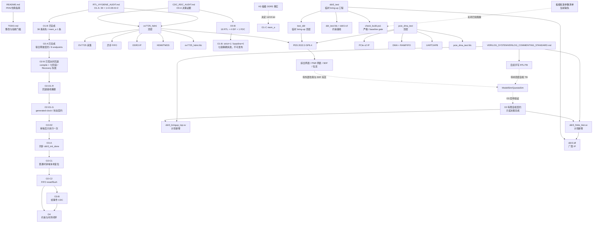

> generated_by: Codex manual bootstrap
> verified_at: 2026-08-30
> provenance: manual inspection of current source tree and PDS artifacts

# Dependencies

## 关键依赖约束

- 三工程的有效器件目标应与板卡实物一致；当前审计基线为 `Logos2 / PG2L100H / FBG484 / -6`。
- 厂商 `.idf`、生成 RTL 和 PDS 仿真库属于外部生成依赖，不应被误当作独立手写逻辑。
- OV7725 O0-A 已识别 `sys_clk`、`i2c_dri_clk`、`cam_pclk`、`pixel_clk`、`pixel_clk_5x`、`clk_50m/ref_clk` 和 `ui_clk`；证据入口为 `41_ov7725_hdmi/doc/CDC_RDC_AUDIT.md`。
- `wr_load` 与 `rd_load` 当前被多个逻辑独立采样；write FIFO 数据方向为 `cam_pclk → ui_clk`，read FIFO 为 `ui_clk → pixel_clk`，两者均需把复位分别在读写时钟域同步释放。
- OV7725 O1-B 已固定 16 个手写 RTL、4 个活动 IDF 和唯一顶层 FDC，从空 `build/` 完成 SP6.4 七阶段，进程退出 0、日志 `E: 0`、warning `4067`、critical `81`，并生成非零综合网表、PNR 网表、SDF、`.sbit` 和 `.bin`。
- OV7725 O1-B 已消除 38 条确定性手写 RTL 位宽告警，只剩精确的 `ddr3_ip.mem_a` 1 条；严格 gate 返回 1，baseline 仅在七组 corner/check/clock pair/endpoints 精确匹配时返回 0，且继续标记不可发布。
- 高有效 reset 已驱动四个 serializer 内的八个 OSERDES。O2-B 曾按 O2-A 契约级联 `pixel_clk_5x` 两级释放并完成 compile/七阶段，但 Slow Recovery 出现 `pixel_clk_5x → pixel_clk_5x -0.349 ns / 8/8` 与 `pixel_clk_5x → pixel_clk -2.173 ns / 8/8`，Fast Recovery 反向组仍为 `-1.464 ns / 8/8`；八个反向 endpoint 正是四个 serializer 的 master/slave OSERDES `OCLKDIV` 检查。
- O2-B 已触发停止条件并完整回退；`check_build.ps1`、旧七组 baseline、FDC/RCF、PLL/IP 和时序例外均未修改。O2-D1 已否决动态门控，唯一待验证候选为 `CLKOUT3=65.0026 MHz`、约 `+0.192 ns` 相位与每 serializer 本地 reset 复制。
- `mem_a` 不属于 O1-B：活动 IP 是 14 bit，顶层/FDC 是 15 bit，综合网表把第 15 bit 绑 0。该冲突转入 H3/O1-C，必须依据 DDR3 料号、组织和原理图决定收窄 RTL/FDC 或重生成 IP。
- OV7725 后续依赖更新为 O2-D1-R → O2-D1-G → 用户审核 → 单次 O2-D2 → O3-A → O2-C1 → O2-C2 → O3-B，O4 同时依赖 O2-C2 与 O3-B。O2-D1-R 重建回退基线并复核 53/54 endpoint；O2-D1-G 固定 `/5` generated-clock/状态契约。O2-D2 失败即完整回退，不扫描第二相位或增加 waiver。
- DDR3 新入口已用 `test_ddr`、`ddr3.idf`、FDC 和 RCF 从空 `build/` 完成七阶段全流程，内部 STA 为 `All Constraints Met`，且综合网表、PNR 网表、SDF 和位流均非零。
- DDR3 严格 gate 因 BIST 位宽/dangling、`rst_board` share pin、BANKR4 VCCIO 3.3、UART I/O 以及输入/输出 timing 共 7 类阻断返回 1；显式 baseline 放行返回 0 但不可发布。日志无 SCBV 命中不等同于板级参数获批，批准清单仍是关闭 gate 的前置依赖。
- DDR3 D2 只读决策不依赖修改厂商示例：`test_ddr`、持续运行 BIST 和旧 testbench 保持原样；D3 若获审核，只新增项目自有 `ddr3_bringup_top.sv` 与 `ddr3_finite_bist.sv`。
- 有限自检契约固定 16 个单 beat 写读比较 pair，地址 `0x0..0x78`、步长 8，pair/run timeout 分别为 4096/131072 周期；签核依赖稳定的 `test_done`、`test_failed`、`failure_code`、`error_count`、`completed_pairs` 和首错信息，而不是厂商 LED 或内部层级。
- 新项目自有 DDR3 RTL 依赖根目录 VSCS；厂商 `ip_core/ddr3/**` 仍作为外部生成依赖，不因 D2 决策被改写。
- DDR3 当前只推进 D3-0 只读 wrapper、非标准 Pango DDR UI 握手和 `I_ips_ddr_top` 层级评审；PCIe 当前只推进 H2-A/H2-B 板级证据矩阵、IP 再生成契约和 baseline gate 精确化，不修改两项目的 IP/RTL/FDC。
- PCIe 顶层依赖专用 HSST/IP 约束；UART2APB 是否保留是后续 RTL 与 FDC 的共同决策点。
- 仿真流程依赖编译后的 Logos2 USIM/VSIM 库和可用的 `vsim.exe`/`vlog.exe`；当前环境不满足该依赖。
