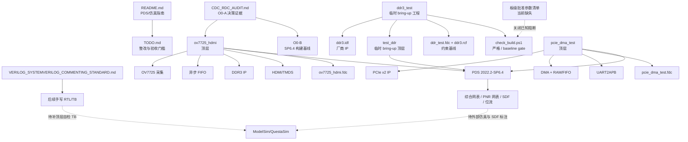

> generated_by: Codex manual bootstrap
> verified_at: 2026-08-29
> provenance: manual inspection of current source tree and PDS artifacts

# Dependencies

## 关键依赖约束

- 三工程的有效器件目标应与板卡实物一致；当前审计基线为 `Logos2 / PG2L100H / FBG484 / -6`。
- 厂商 `.idf`、生成 RTL 和 PDS 仿真库属于外部生成依赖，不应被误当作独立手写逻辑。
- OV7725 O0-A 已识别 `sys_clk`、`i2c_dri_clk`、`cam_pclk`、`pixel_clk`、`pixel_clk_5x`、`clk_50m/ref_clk` 和 `ui_clk`；证据入口为 `41_ov7725_hdmi/doc/CDC_RDC_AUDIT.md`。
- `wr_load` 与 `rd_load` 当前被多个逻辑独立采样；write FIFO 数据方向为 `cam_pclk → ui_clk`，read FIFO 为 `ui_clk → pixel_clk`，两者均需把复位分别在读写时钟域同步释放。
- OV7725 旧 STA 的三条直接证据为 `rd_load` 裸 CDC `-7.056 ns`、read FIFO 指针路径 `-2.279 ns`、`ddr3_init_done` 到 pixel reset recovery `-4.857 ns`。
- OV7725 结构契约固定为逐域复位、单点事件同步、FIFO 分侧复位和结构闭环后的精确例外；O0-B 先建立 SP6.4 构建基线，不提前添加宽泛 `false_path`。
- DDR3 新入口已用 `test_ddr`、`ddr3.idf`、FDC 和 RCF 从空 `build/` 完成七阶段全流程，内部 STA 为 `All Constraints Met`，且综合网表、PNR 网表、SDF 和位流均非零。
- DDR3 严格 gate 因 BIST 位宽/dangling、`rst_board` share pin、BANKR4 VCCIO 3.3、UART I/O 以及输入/输出 timing 共 7 类阻断返回 1；显式 baseline 放行返回 0 但不可发布。日志无 SCBV 命中不等同于板级参数获批，批准清单仍是关闭 gate 的前置依赖。
- PCIe 顶层依赖专用 HSST/IP 约束；UART2APB 是否保留是后续 RTL 与 FDC 的共同决策点。
- 仿真流程依赖编译后的 Logos2 USIM/VSIM 库和可用的 `vsim.exe`/`vlog.exe`；当前环境不满足该依赖。
