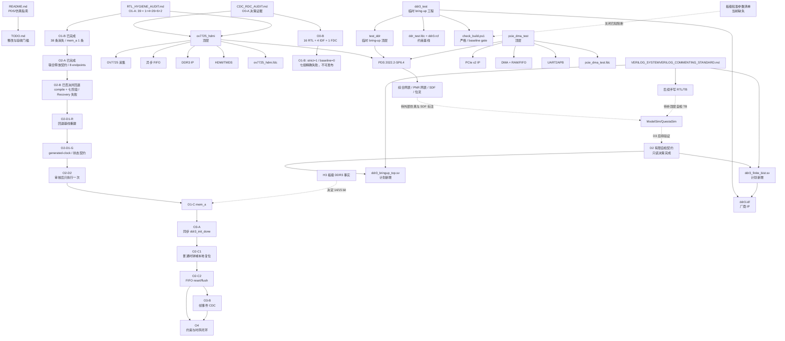

> generated_by: Codex manual bootstrap
> verified_at: 2026-08-30
> provenance: manual inspection of current source tree and PDS artifacts

# Dependencies

## 关键依赖约束

- 用户于 2026-08-30 确认三个工程共用 `RK3568+PG2L50H100H` 开发板，实际 FPGA 为 `PG2L50H-6IFBG484`；统一有效 PDS 目标为 `Logos2 / PG2L50H / FBG484 / -6`。旧 PG2L100H 实现、STA 和位流均不得用于实板。
- 厂商 `.idf`、生成 RTL 和 PDS 仿真库属于外部生成依赖，不应被误当作独立手写逻辑。
- OV7725 O0-A 已识别 `sys_clk`、`i2c_dri_clk`、`cam_pclk`、`pixel_clk`、`pixel_clk_5x`、`clk_50m/ref_clk` 和 `ui_clk`；证据入口为 `41_ov7725_hdmi/doc/CDC_RDC_AUDIT.md`。
- `wr_load` 与 `rd_load` 当前被多个逻辑独立采样；write FIFO 数据方向为 `cam_pclk → ui_clk`，read FIFO 为 `ui_clk → pixel_clk`，两者均需把复位分别在读写时钟域同步释放。
- OV7725 O1-B 已固定 16 个手写 RTL、4 个活动 IDF 和唯一顶层 FDC，从空 `build/` 完成 SP6.4 七阶段，进程退出 0、日志 `E: 0`、warning `4067`、critical `81`，并生成非零综合网表、PNR 网表、SDF、`.sbit` 和 `.bin`。
- OV7725 O1-B 已消除 38 条确定性手写 RTL 位宽告警，只剩精确的 `ddr3_ip.mem_a` 1 条；严格 gate 返回 1，baseline 仅在七组 corner/check/clock pair/endpoints 精确匹配时返回 0，且继续标记不可发布。
- 高有效 reset 已驱动四个 serializer 内的八个 OSERDES。O2-B 曾按 O2-A 契约级联 `pixel_clk_5x` 两级释放并完成 compile/七阶段，但 Slow Recovery 出现 `pixel_clk_5x → pixel_clk_5x -0.349 ns / 8/8` 与 `pixel_clk_5x → pixel_clk -2.173 ns / 8/8`，Fast Recovery 反向组仍为 `-1.464 ns / 8/8`；八个反向 endpoint 正是四个 serializer 的 master/slave OSERDES `OCLKDIV` 检查。
- O2-B 已触发停止条件并完整回退；`check_build.ps1`、旧七组 baseline、FDC/RCF、PLL/IP 和时序例外均未修改。O2-D1 已否决动态门控，O2-D1-G 进一步冻结唯一候选：`CLKOUT3=65.0026 MHz`、约 `+0.192 ns` 相位、每 serializer 本地 reset 复制，以及唯一 `/5` generated-clock（`u_pll_clk/clkout1` → 唯一 `GTP_IOCLKDIV_E2.CLKDIVOUT`，`-edges {1 5 11}`）。
- `mem_a` 不属于 O1-B：活动 IP 是 14 bit，顶层/FDC 是 15 bit，综合网表把第 15 bit 绑 0。该冲突转入 H3/O1-C，必须依据 DDR3 料号、组织和原理图决定收窄 RTL/FDC 或重生成 IP。
- OV7725 O2-D1-R 与 O2-D1-G 是旧 PG2L100H 基线上的历史证据；必须先用 SP6.4 为 PG2L50H 重生成四个活动 IP并建立新 baseline，再重新审核 O2-D2。重新审核通过后仍只允许一次实现；任一 generated-clock、waveform、端点覆盖或新 baseline 失败即完整回退，不扫描第二相位或增加 waiver。
- DDR3 新入口已用 `test_ddr`、`ddr3.idf`、FDC 和 RCF 从空 `build/` 完成七阶段全流程，内部 STA 为 `All Constraints Met`，且综合网表、PNR 网表、SDF 和位流均非零。
- DDR3 M2 只读审计（2026-08-30）确认：活动 `ddr3_test/ddr3_test/ip_core/ddr3/ddr3.idf` metadata 为 `Logos2/PG2L100H/FBG484/-6`，生成器为 `2022.2-SP6.4`；canonical 约束是 `ip_core/ddr3/pnr/ddr_test.fdc` 与 `ip_core/ddr3/pnr/ddr3.rcf`。外层 `ip_core/ddr_test.fdc` 仅作为旧硬宏位置参考，不得覆盖 canonical 约束。
- DDR3 现存 `ip_backup/20250108100125/ddr3/ddr3.idf` 虽标识 `Logos2/PG2L50H/FBG484/-6`，但由 `2022.2-SP6.1` 生成；它只能用于参数/器件差异比对，不能直接恢复、复制或作为 SP6.4 发布输入。M2 必须在 SP6.4 中重新生成 controller、PHY、wrapper、仿真资产、FDC 和 RCF。
- DDR3 M2-A（2026-08-30）新增项目自有 `scripts/regenerate_ip.ps1` 和 `doc/M2_IP_REGENERATION.md`。脚本只复制 canonical IP 到 `build/ipgen/pg2l50h` 后调用 SP6.4 build 146967；本次 `Logos2/PG2L50H/FBG484/-6` staging 生成退出 0，日志为 `0 error(s), 0 warning(s)`，canonical IDF SHA-256 前后均为 `6CB70BF0954100B4797197A47F20496AD74945995E12B30FA040870EE3366C47`。
- M2-A 差异边界：`ddr3.v`、`ddr3_ddrphy_top.v`、`pnr/ddr3.rcf` 与 canonical 相同；`example_design/rtl/test_ddr.v`、`pnr/ddr_test.fdc`、`ddr3.idf` 不同。50H wrapper 保留 `free_clk` 并新增 `ref_clk_p/ref_clk_n` 和 `GTP_INBUFDS`，FDC 使用 `DDRPHY_CPD_297_4`。生成后 `DEVICE_100H_EN` 仍为 `true`，其语义必须先确认，禁止手工改 XML 或生成 RTL。
- M2 后续门禁固定为：锁定板级 DDR3 颗粒/组织/PCB 参数并确认 `DEVICE_100H_EN` 语义 → 审核 staging wrapper/FDC/RCF → 才可升格 canonical → 重跑 CI-6（端口、宽度、地址单位、`axi_wready` 与 `I_ips_ddr_top`）→ 清空 `build/` 完成七阶段 → 重新审核 D3-0-R，之后才可请求 D3-A。M2-A 本身不授权 canonical 替换、产品 RTL 或烧录。
- DDR3 严格 gate 因 BIST 位宽/dangling、`rst_board` share pin、BANKR4 VCCIO 3.3、UART I/O 以及输入/输出 timing 共 7 类阻断返回 1；显式 baseline 放行返回 0 但不可发布。日志无 SCBV 命中不等同于板级参数获批，批准清单仍是关闭 gate 的前置依赖。
- DDR3 D2 只读决策不依赖修改厂商示例：`test_ddr`、持续运行 BIST 和旧 testbench 保持原样；D3 若获审核，只新增项目自有 `ddr3_bringup_top.sv` 与 `ddr3_finite_bist.sv`。
- DDR3 D3-0（2026-08-30）已完成旧活动 `ddr3` 核、非标准 AXI-like AW/W/AR/R 握手和 `I_ips_ddr_top` 边界评审，CI-6 提交 `a5d1785` 已保护该静态契约；目标迁移后必须先重生成 PG2L50H DDR3 IP/FDC/RCF并重新审核 D3-A。
- D3-0 旧接口结论只能作为 PG2L50H 重生成后的比对基准；若接口语义、地址单位、端口或 `I_ips_ddr_top` 层级变化，停止并重新更新 D3-0-R/CI-6，审核前不得新增 D3-A/B/C RTL。
- 有限自检契约固定 16 个单 beat 写读比较 pair，地址 `0x0..0x78`、步长 8，pair/run timeout 分别为 4096/131072 周期；签核依赖稳定的 `test_done`、`test_failed`、`failure_code`、`error_count`、`completed_pairs` 和首错信息，而不是厂商 LED 或内部层级。
- 新项目自有 DDR3 RTL 依赖根目录 VSCS；厂商 `ip_core/ddr3/**` 仍作为外部生成依赖，不因 D2 决策被改写。
- 当前执行队列增加统一器件迁移前置：PCIe 修 build/gate并建立 50H baseline；DDR3 重生成 50H IP/FDC/RCF并重审 D3-A；OV7725 重生成四个 50H IP、建立 baseline并重审 O2-D2。之后才进入 D3-A/B/C、单次 O2-D2、H2-B 与 S1/S2/S3。
- `docs/SIMULATION_READINESS_MATRIX.md` 已确认三个项目的项目级 TB、`.f`、`.do` 均缺失；厂商示例不形成产品顶层覆盖。S1 还依赖 PG2L50H DDR3 IP契约、D3-A/B/C 与 D4，S2 依赖 H2-B/PG2L50H 产物一致性，S3 依赖 PG2L50H 新 baseline、输入格式契约与 O2-D2/O3 RTL 锁定。
- PCIe 顶层依赖专用 HSST/IP 约束；UART2APB 是否保留是后续 RTL 与 FDC 的共同决策点。
- PCIe H2-A（2026-08-30）固定顶层 x2 `rxn/rxp/txn/txp`、差分 `ref_clk_p/n`、`perst_n`/`button_rst_n` 与两枚 LED；FDC 当前映射 refclk `F6/E6`、PERST# `M16`、button reset `M15`、LED `M17/J16`。
- 活动 PCIe `pcie_test.idf` 已正确匹配 `Logos2/PG2L50H/FBG484/-6`，无需仅为器件型号重生成；必须修正的是 PG2L100H build/PDS/gate并清除旧 `build/` 后重建。lane 极性、板级拓扑、I/O delay 和 SCBV 仍是独立缺口。
- UART2APB 在 `pcie_dma_test.v` 以隐式 `rxd/txd` 网络连接，当前 `rxd` 被绑 0；H2-A 只记录该功能缺口，H2-B 需先决定端口归属和板级连接。
- H2-A 器件审核已解除项目自有 build/gate 的只读限制；活动 IDF 保持 50H，RTL/FDC 仍等待 UART 与板级证据。H2-B 在 lane/refclk/PERST#/SCBV 和 UART 均闭合前不得宣称发布通过。
- S0 环境复核（2026-08-30）确认 `E:/pango/PDS_2022.2-SP6.4/bin/pds_shell.exe` 存在，是唯一已发现工具；PATH、`C:/questasim64/win64` 和常见 ModelSim/QuestaSim 目录均未找到 `vsim.exe`、`vlog.exe`、`vlib.exe`。
- S0-1 已准备 `scripts/compile_simlib.ps1` → 环境变量 → `scripts/compile_simlib.tcl` → PDS `compile_simlib` 的参数化链路，可选择 ModelSim/QuestaSim、USIM/VSIM/BOTH、family、语言、工具路径与输出目录；入口准备不等于库已生成。
- 仿真流程仍依赖可用且有许可证的 `vsim.exe`/`vlog.exe`/`vlib.exe` 与编译后的 Logos2 USIM/VSIM 库；默认运行因 `vsim.exe` 缺失在 PDS 前返回 1，动态仿真在实际编译退出 0、日志无 `E:` 且库目录非空前保持阻塞。
- CI-0 仓库级静态一致性门禁依赖根指南/TODO/VSCS、三个项目 README 与各自 `build.tcl`/`run.ps1`/`check_build.ps1`；当前工作区门禁退出码为 0，7 个 PowerShell 脚本 AST 解析错误数为 0。它只验证结构、入口与文档关系，不解除任何 PDS、STA、板级或仿真阻断。
- CI-2 在 CI-0 上增加三项目板级证据清单路径、项目关键词、README 链接和统一章节门禁；清单结构通过只允许继续收集证据，不会自动解锁 H0/H1/H2/H3、PCIe H2-B 或 DDR3/OV7725 板级整改。
