> generated_by: Codex manual bootstrap
> verified_at: 2026-09-04
> provenance: manual inspection of current source tree and PDS artifacts

# Dependencies

```mermaid
flowchart TD
  Guide["README.md\nPDS/仿真指南"] --> Todo["TODO.md\n整改与验收门槛"]
  Standard["VERILOG_SYSTEMVERILOG_COMMENTING_STANDARD.md"] --> HandRTL["后续手写 RTL/TB"]

  MainOV["main_ov5640_pcie\nM1-A→M3-A"] --> MainCapture["DVP 8-bit→RGB565\ncam_pclk 单域"]
  MainCapture --> MainProcess["M2-A RGB565 灰度\n固定一拍"]
  MainProcess --> MainPack["M3-A 8×RGB565\n128-bit 内部字"]
  MainPack --> MainSkid["M3-B 两槽 word skid\n前缀保留 + 唯一中止"]
  MainSkid --> MainStaging["M3-B CDC staging\n4-byte beat + 下一帧恢复"]
  MainStaging --> MainDDRRecord["规范化 DDR3 写记录\npayload + 第5 byte 元数据"]
  MainDDRRecord --> MainDDRWriteAdapter["PG2L50H DDR write adapter\nAW/W + init 两拍同步"]
  MainDDRWriteAdapter --> CanonicalDDRPort["canonical DDR3 用户口\n单 beat AW/W/AR/R"]
  CanonicalDDRPort --> MainDDRReadAdapter["PG2L50H DDR read adapter\nAR/R + 必需本地缓冲"]
  MainDDRReadAdapter --> MainReadScheduler
  MainDDRRecord --> MainDDRModel["旧 TB DDR3 模型\n按记录保存/回读"]
  MainDDRModel --> MainMWR["规范化 PCIe MWR\npayload length=1\nkeep=0 本地消费"]
  MainMWR --> MainMWRBridge["保持型 mwr32 bridge\nreq/ack"]
  MainVendorTXTB["隔离 vendor TX 集成 TB\n136 ns PASS"] --> MainMWRBridge
  MainVendorTXTB --> CanonicalMWRTX["未修改 canonical MWR TX\n1 DWORD / keep=F / aligned"]
  MainCanonicalLoopbackTB["canonical AW/W→AR/R→async mailbox→arbiter→MWR TX TB\n1086 ns PASS"] --> MainDDRWriteAdapter
  MainCanonicalLoopbackTB --> MainDDRReadAdapter
  MainCanonicalLoopbackTB --> MainMWR
  MainDDRRecord --> MainFrameCommit["M3-B frame commit\nDDR 接受后统计"]
  MainFrameCommit --> MainSlotTable["M3-B 双槽帧控制面\n2-slot FIFO + 单 reader"]
  MainSlotTable --> MainDDRRecord
  MainSlotTable --> MainReadScheduler["M3-B frame read scheduler\n带槽单 outstanding 顺序命令"]
  MainReadScheduler --> MainReadoutGate["M3-B frame readout gate\n仅正常提交帧开放"]
  MainReadoutGate --> MainCommittedMWR["committed PCIe MWR\n0x2000 起始"]
  MainCommittedMWR --> MainAsyncMailbox["MWR32 async mailbox\ncore_clk→pclk_div2\nsingle outstanding"]
  MainAsyncMailbox --> MainTxCdcArbiter["TX CDC arbiter\nmailbox + WAIT_ACK_LOW"]
  MainNativeTx["native DMA TX bundle\nPCIe pclk_div2"] --> MainTxCdcArbiter
  MainTxCdcArbiter --> CanonicalMWRTX
  MainMailboxTB["mailbox/CDC TX TB\n2296/385 ns PASS"] --> MainAsyncMailbox
  MainMailboxTB --> MainTxCdcArbiter
  MainLoopbackTB["tb_ov5640_ddr3_pcie_loopback\n行为级闭环"] --> MainStaging
  MainLoopbackTB --> MainDDRModel
  MainLoopbackTB --> MainMWR
  MainCommitTB["frame_commit/scheduler/gate/committed MWR TB\n240/346/211/656 ns"] --> MainFrameCommit
  MainCommitTB --> MainReadScheduler
  MainCommitTB --> MainReadoutGate
  MainCommitTB --> MainCommittedMWR
  MainSlotTB["tb_rgb565_axis4_frame_slot_table\n436 ns"] --> MainSlotTable
  MainCommittedLoopbackTB["tb_ov5640_ddr3_committed_pcie_loopback\n4194 ns"] --> MainDDRModel
  MainCommittedLoopbackTB --> MainFrameCommit
  MainCommittedLoopbackTB --> MainReadScheduler
  MainCommittedLoopbackTB --> MainCommittedMWR
  MainSlotTable --> MainCommittedLoopbackTB
  MainTB["M1-A 自检 TB"] --> MainCapture
  Standard --> MainCapture
  Standard --> MainPack
  MainPack -. "行为切片，未进入实现" .-> PDS
  MainSkid -. "持续背压仍可整帧丢弃" .-> PDS
  Parallel["parallel_driver\n只读参考"] -. "不得导入资产/证据" .-> MainOV

  OV5640Target["OV5640 摄像头 HDMI\n产品目标 C0-C3/S3"] -. "C2 审核后选择性迁移" .-> OVLegacy["41_ov7725_hdmi\nOV7725 legacy"]
  OVLegacy --> Camera["OV7725 legacy 采集"]
  OVLegacy --> OVFifo["异步 FIFO"]
  OVLegacy --> OVDDR["DDR3 IP"]
  OVLegacy --> HDMI["HDMI/TMDS"]
  OVLegacy --> OVFdc["ov7725_hdmi.fdc"]
  OVAudit["CDC_RDC_AUDIT.md\nO0-A legacy 证据"] --> OVLegacy
  OVAudit --> OVBuild["O0-B\n16 RTL + 4 IDF + 1 FDC"]
  OVBuild --> OVGate["O1-B: strict=1 / baseline=0\n七组精确失败，不可发布"]
  OVHygiene["RTL_HYGIENE_AUDIT.md\nO1-A legacy 证据"] --> OVLegacy
  OVHygiene --> OVFix["O1-B 已完成\n38 条消失 / mem_a 1 条"]
  OVFix --> OVResetAudit["O2-A 已完成\n联合释放契约 / 8 endpoints"]
  OVResetAudit --> OVResetRejected["O2-B 已否决并回退\ncompile + 七阶段 / Recovery 失败"]
  OVResetRejected --> OVBaseline["O2-D1-R\n回退基线重建"]
  OVBaseline --> OVResetReview["O2-D1-G\ngenerated-clock / 状态契约"]
  OVResetReview --> OVResetImpl["O2-D2\n审核后只执行一次"]
  OVResetImpl --> OVMemA["O1-C mem_a"]
  OVMemA --> OVInitSync["O3-A\n同步 ddr3_init_done"]
  OVInitSync --> OVDomainReset["O2-C1\n普通时钟域本地复位"]
  OVDomainReset --> OVFifoReset["O2-C2\nFIFO reset/flush"]
  OVFifoReset --> OVEventCdc["O3-B\n帧事件 CDC"]
  OVFifoReset --> OVTimingClose["O4\n约束与时序闭环"]
  OVEventCdc --> OVTimingClose
  OVBoard["H3 板级 DDR3 事实"] -. "决定 14/15 bit" .-> OVMemA

  DDRBringup["ddr3_test\n临时 bring-up 工程"] --> DDRIdf["ddr3.idf\n厂商 IP"]
  DDRBringup --> DDRExample["test_ddr\n临时 bring-up 顶层"]
  DDRBringup --> DDRFdc["ddr_test.fdc + ddr3.rcf\n约束基线"]
  DDRBringup --> DDRGate["check_build.ps1\n严格 / baseline gate"]
  DDRBoard["板级批准参数清单\n当前缺失"] -. "关闭已知阻断" .-> DDRGate
  DDRContract["D2 有限自检契约\n只读决策完成"] --> DDRTop["ddr3_bringup_top.sv\n计划新增"]
  DDRContract --> DDRBist["ddr3_finite_bist.sv\n计划新增"]
  DDRBist --> DDRIdf
  Standard --> DDRTop
  Standard --> DDRBist
  Questa -. "D3 后待验证" .-> DDRContract

  PCIeTop["pcie_dma_test\n顶层"] --> PCIeIP["PCIe x2 IP"]
  PCIeTop --> DMA["DMA + RAM/FIFO"]
  DMA --> CanonicalMWRTX
  PCIeTop --> UART["UART2APB"]
  PCIeTop --> PCIeFdc["pcie_dma_test.fdc"]
  PCIeSmoke["S2-A 项目级行为 smoke\n真实顶层 + 受控 PCIe 边界"] --> PCIeTop
  PCIeSources["pds_sources.f\n37 canonical HDL"] --> PCIeSmoke
  PCIeSmoke --> PCIeStaticGate["check_sim.ps1\n静态契约 gate=0"]
  SharedUSIM["仓库根 build/simlib/usim\nLogos2 USIM"] --> PCIeSmoke
  PCIeSmoke -. "当前许可证 checkout 失败，退出 4" .-> Questa
  PCIeRealLink["S2-B\n真实厂商 RC/EP"] --> PCIeDMAReadback["S2-C\n基础 DMA 回读"]
  PCIeTop --> PCIeRealLink

  OVLegacy --> PDS["PDS 2022.2-SP6.4"]
  DDRExample --> PDS
  PCIeTop --> PDS
  PDS --> Reports["综合网表 / PNR 网表 / SDF / 位流"]
  Reports -. "待外部仿真与 SDF 标注" .-> Questa["ModelSim/QuestaSim"]
  HandRTL -. "待补顶层自检 TB" .-> Questa
```

## 关键依赖约束

- `main_ov5640_pcie/` 位于 `codex/main-ov5640-pcie`，M1-A 只依赖项目自有采集 RTL/TB 与公开合同；`parallel_driver` 仅只读参考，未导入 RTL、IP、约束、PDS 产物或验收证据。
- M1-A 的 VSYNC/HREF/字节序/坐标事件均属于 `cam_pclk` 域合同。SCCB、板级时序、CDC/FIFO、DDR3 和 PCIe 是后续独立依赖，不能由当前唯一 `TEST PASS` 推导为通过。
- M2-A 在同一 `cam_pclk` 域把 M1-A 采集输出送入 `rgb565_grayscale`；处理职责止于 RGB565 灰度化和一拍事件/坐标对齐，不延伸为 SCCB、板级时钟/电气时序、CDC/FIFO、DDR3、PCIe 或主机协议实现。
- M2-A 的算法依赖 RGB565 分量扩展与固定整数系数 `77/150/29`；TB 参考值、系数、分量扩展或寄存器级数变化必须同步更新，当前证据只覆盖四个颜色样本、两行坐标、边界事件和奇数字节错误。
- `run_m2a.ps1` 依赖外部提供的 Questa 可执行文件，通过参数注入模拟器目录；脚本在独立 `build/m2a/<run-id>/` 中编译并要求日志出现恰好一次 `TEST PASS`。Nexus 不记录模拟器安装路径、许可证或凭证。
- M3-A 的 `ov5640_dvp_rgb565_word_pipeline` 承接 M2-A 同域灰度输出；`rgb565_word_packer` 按接收顺序将 8 个 RGB565 像素打成 128-bit 字，部分行尾只置 `word_keep` 低 `2N` 位并补零。该关系不改变 M2-A 的图像处理职责。
- M3-A 的两个 TB 已按新协议区分 payload（`word_valid && word_keep!=0`）与纯控制事件（`word_valid=1`、`word_keep=0`）；帧/行起止和协议错误可按该规则传播。内部 keep 只表达 16 个 byte lane，不等同于厂商 PCIe AXIS `tkeep` 或主机字节序。
- `run_m3a.ps1` 编译 5 个 RTL 与 1 个集成 TB，并要求 Questa 日志唯一 `TEST PASS`；2026-09-03 的 6 模块 `0 error/0 warning` 结果只证明板级无关行为，仍受 VSCS 与统一 PDS/四级仿真边界约束。
- `rgb565_axis4_mwr_descriptor` 只对 payload 生成请求：`req_length_dw` 表示实际 DWORD 数且固定为 `1`；`keep=0` 控制记录在 descriptor 本地接受，不依赖 bridge/vendor ACK，不产生 MWR，不推进 PCIe 字节地址。
- `tb_rgb565_pg2l50h_mwr32_tx_integration.sv` 同时依赖项目 bridge 与未修改 `pcie_dma_test_100h/hdl/pcie_dma_ctrl/ips2l_pcie_dma_mwr_tx_ctrl.v`；该旧隔离测试只验证保持型 req/ack 和单 DWORD TLP 输出，本身不实例化新增仲裁器或 mailbox，也不覆盖完整 TX 顶层、PCIe link training 或主机内存。
- canonical MWR TX 固定 full-DWORD byte enable；当前只有 `keep=4'hf`、4 字节对齐请求可无损进入该隔离边界，partial keep 仍是未关闭依赖。
- `rgb565_pg2l50h_pcie_tx_request_arbiter` 依赖 canonical DMA controller 的完整共享请求合同：native `MWR32/MWR64/MRD32/MRD64` 必须连同 `user_define_data_flag/length/address/data` 作为一个原子 bundle；camera 只注入 MWR32。两源在 PCIe 域轮转，owner/字段保持到匹配 ACK，ACK 只返回 owner。MWR user-defined 模式在 MWR ACK 时锁存，native MRD 不改写，并保持到下一次 MWR；握手后进入 `WAIT_ACK_LOW`，vendor ACK 撤销前不得换 owner或发布下一事务。
- `tb_rgb565_pg2l50h_pcie_tx_request_arbiter.sv` 的 265 ns 专项验证四类 native request、轮转、字段保持、ACK 隔离、复位、下游 ACK/已完成源请求双低释放和 MWR 模式保持；`tb_rgb565_pg2l50h_pcie_tx_arbiter_integration.sv` 的 205 ns 集成验证 native RAM-data 与 camera user-defined 依次经过未修改 vendor MWR TX。两项均未实例化完整 `ips2l_pcie_dma_tx_top`，也不提供 partial keep、链路或 RK3568 证据。
- `rgb565_pg2l50h_pcie_mwr32_async_mailbox` 依赖源 payload 在 request token 发出后保持到 ACK 返回的 bundled-data MCP；online/fault 单比特状态保持目标域两级同步，request/ACK token 使用三级同步，确保 peer-offline 先于事务 token 到达事务逻辑；目标检测 token 后额外等待一拍再采样 length/address/data。不得把整条 payload 总线简单设为 false-path；placed-design 必须签核 max-delay/bus-skew。
- mailbox 只允许单 outstanding。在线 reset handshake 在双方 channel-ready 前阻止新请求；idle 单域复位可重新对齐，在途任一域复位则 pulse/sticky fault、禁止自动 replay，并要求上层作废 frame/slot 后协调 flush。目标端和下游 arbiter 都依赖 `WAIT_ACK_LOW` 隔离保持型 vendor ACK。
- `rgb565_pg2l50h_pcie_tx_cdc_arbiter` 组合 mailbox 与现有请求仲裁器：camera 请求从 DDR `core_clk` 跨到 PCIe `pclk_div2`，native bundle 保持在 PCIe 域。mailbox 专项 2296 ns、CDC arbiter→未修改 MWR TX 集成 385 ns，均 0 error/0 warning、唯一 `TEST PASS`；行为级 CDC 已实现，CDC/RDC/STA 与 placed-design timing 尚未签核。
- `rgb565_axis4_ddr3_write_descriptor` 把 payload 放入 byte 0..3，把 `keep/last/frame_end/protocol_error` 放入第 5 byte，并固定 `write_strb[4]=1`；因此 `keep=0` 控制记录仍依赖 canonical AW/W 事务保存元数据，而不会在 DDR 写侧被本地吞掉。
- `rgb565_pg2l50h_ddr3_write_adapter` 依赖公开 canonical AW/W 合同：`ddr_init_done` 经两拍 `io_clk` 同步后准入，单 outstanding、`AWLEN=0`，上游完成只发生在 `axi_wready` 消费数据时。221 ns 专项与 196 ns writer→adapter 路径已通过，但该完成不证明物理 DDR 持久化。
- `rgb565_pg2l50h_ddr3_read_adapter` 依赖公开 canonical AR/R 合同：单 outstanding、`ARLEN=0`；由于 core 没有 `axi_rready`，适配器必须本地缓冲返回拍。RID/RLAST 异常并入记录协议错误，非预期或重复 RVALID 形成 `port_fault_pulse`；191 ns 专项已通过。
- `tb_ov5640_ddr3_pcie_loopback.sv` 依赖现有 DVP/灰度/打包/短缓冲/CDC staging、规范化 DDR3 写记录和规范化 PCIe MWR 路径；TB 自带的 DDR3 数组模型只把 opaque 28-bit 写地址当作索引，不解释真实控制器地址单位或读写握手。
- `run_m3b_ov5640_ddr3_pcie_loopback.ps1` 依赖外部 Questa Sim-64 2021.1，可执行文件目录由参数或 `QUESTA_BIN` 提供；每次运行使用独立 `build/m3b-ov5640-ddr3-pcie-loopback/<run-id>/`，要求仿真退出成功、Errors 为 0 且 `TEST PASS` 恰好一次。
- 规范化 PCIe 地址只在 payload request 接受后按有效字节数推进；空载 abort/帧尾记录不产生 MWR，不占用 vendor TX 地址。这不改变 TB DDR3 模型仍是 opaque token 的边界。
- `ov5640_dvp_rgb565_ddr3_pcie_pipeline` 把 slot table 的 `slot/base/capacity` 分配接入 writer，并在 DDR write 接受后才向 frame commit 交付同一记录；committed 描述符携 slot id 进入 scheduler，带槽 done 释放匹配 READING 槽。完整 4194 ns 回归还验证空控制响应不生成 MWR但正常回收槽；它仍只依赖 TB 数组 token 与规范化 MWR，不能外推为真实 DDR3/PCIe/RK3568 闭环。
- `ov5640_dvp_rgb565_pg2l50h_pcie_pipeline` 在上述双槽控制面外接入 canonical write/read adapters；更新后的 1086 ns TB 在其 MWR32 输出后串接异步 mailbox、native/camera 仲裁与未修改 vendor MWR TX，覆盖 AW/W 写记录、第 5 byte 元数据存储、AR/R 读回、`core_clk`→`pclk_div2` 和两组 TLP header/data。该 TB 的可见 DDR 存储仍是公开端口模型，未实例化加密 DDR core；不能外推为正式地址单位/物理槽、placed-design max-delay/bus-skew、CDC/RDC/STA、full tx_top/产品顶层、PCIe 链路、RK3568 软件或板级闭环。
- 用户确认三个产品方向共用 `RK3568+PG2L50H100H` 开发板，实际 FPGA 为 `PG2L50H-6IFBG484`；摄像头产品目标已校正为 OV5640，`41_ov7725_hdmi` 仅作 OV7725 legacy。统一有效 PDS 目标为 `Logos2 / PG2L50H / FBG484 / -6`，旧 PG2L100H 产物不得用于实板。
- 厂商 `.idf`、生成 RTL 和 PDS 仿真库属于外部生成依赖，不应被误当作独立手写逻辑。
- PCIe S2-A 的 `sim/behav.f` 依赖 37 个实现侧 canonical HDL、仿真专用补充源、DMA RAM init include、reset helper、项目 TB 与受控边界模型。历史动态 smoke 已通过同一 run-id 和唯一 `TEST PASS`；当前 S2-A/S2-B 静态门禁通过，但动态复验因仓库外许可证 checkout 失败返回 4，未产生新 PASS。
- 每次 S2-A 动态运行按 `SIM_RUN_ID` 创建独立 `build/sim/behav/<run_id>/work`，避免上一次编译的 work library 被误用；日志身份、work 隔离和公共 USIM 是三个不同依赖，均不能由单独一个 `TEST PASS` 替代。
- S2-A 的受控 link indication 只驱动顶层复位、LED 和未知态检查，不能替代 S2-B 的真实厂商 RC/EP、LTSSM/TLP，也不能替代 S2-C 的 DMA 数据回读。`SIM_RUN_ID` 与唯一 `TEST PASS` 只绑定一次仿真日志，不扩张覆盖范围。
- OV7725 O0-A 已识别 `sys_clk`、`i2c_dri_clk`、`cam_pclk`、`pixel_clk`、`pixel_clk_5x`、`clk_50m/ref_clk` 和 `ui_clk`；证据入口为 `41_ov7725_hdmi/doc/CDC_RDC_AUDIT.md`。
- `wr_load` 与 `rd_load` 当前被多个逻辑独立采样；write FIFO 数据方向为 `cam_pclk → ui_clk`，read FIFO 为 `ui_clk → pixel_clk`，两者均需把复位分别在读写时钟域同步释放。
- OV7725 O1-B 已固定 16 个手写 RTL、4 个活动 IDF 和唯一顶层 FDC，从空 `build/` 完成 SP6.4 七阶段，进程退出 0、日志 `E: 0`、warning `4067`、critical `81`，并生成非零综合网表、PNR 网表、SDF、`.sbit` 和 `.bin`。
- OV7725 O1-B 已消除 38 条确定性手写 RTL 位宽告警，只剩精确的 `ddr3_ip.mem_a` 1 条；严格 gate 返回 1，baseline 仅在七组 corner/check/clock pair/endpoints 精确匹配时返回 0，且继续标记不可发布。
- 高有效 reset 已驱动四个 serializer 内的八个 OSERDES。O2-B 曾按 O2-A 契约级联 `pixel_clk_5x` 两级释放并完成 compile/七阶段，但 Slow Recovery 出现 `pixel_clk_5x → pixel_clk_5x -0.349 ns / 8/8` 与 `pixel_clk_5x → pixel_clk -2.173 ns / 8/8`，Fast Recovery 反向组仍为 `-1.464 ns / 8/8`；八个反向 endpoint 正是四个 serializer 的 master/slave OSERDES `OCLKDIV` 检查。
- O2-B 已触发停止条件并完整回退；`check_build.ps1`、旧七组 baseline、FDC/RCF、PLL/IP 和时序例外均未修改。O2-D1 已否决动态门控，O2-D1-G 进一步冻结唯一候选：`CLKOUT3=65.0026 MHz`、约 `+0.192 ns` 相位、每 serializer 本地 reset 复制，以及唯一 `/5` generated-clock（`u_pll_clk/clkout1` → 唯一 `GTP_IOCLKDIV_E2.CLKDIVOUT`，`-edges {1 5 11}`）。
- `mem_a` 不属于 O1-B：活动 IP 是 14 bit，顶层/FDC 是 15 bit，综合网表把第 15 bit 绑 0。该冲突转入 H3/O1-C，必须依据 DDR3 料号、组织和原理图决定收窄 RTL/FDC 或重生成 IP。
- OV7725 O2-D1-R 与 O2-D1-G 是旧 PG2L100H 基线上的历史证据；必须先用 SP6.4 为 PG2L50H 重生成四个活动 IP并建立新 baseline，再重新审核 O2-D2。重新审核通过后仍只允许一次实现；任一 generated-clock、waveform、端点覆盖或新 baseline 失败即完整回退，不扫描第二相位或增加 waiver。
- OV7725 M3-A 已证明旧 IDF 不能直接迁移：活动/安装版本为 DDR3 `1.12/1.10`、PLL `1.3/1.5`、FIFO `1.8/1.10`，探针以 `IPCompiler 0037/0057` 失败。M3-B 唯一入口是 SP6.4 GUI 新建 PG2L50H 当前版本实例，输出只到 `build/ipgen/pg2l50h/**`；禁止旧 IDF override、版本字段编辑和 canonical 原地生成。
- M3-B 的派生与资源依赖固定为 DDR3 `DEVICE_100H_EN=false`、PLL `DEVICE_PG2L50H=true`、FIFO 不超过 85 个 DRM36K/170 个 DRM18K；真实 DDR3 颗粒/组织、row14/15、byte lane、VCCIO/VREF/ODT、I/O pin 与 RCF 对象命中未审核时，四 IP 不得升格或用于 50H 构建。
- DDR3 新入口已用 `test_ddr`、`ddr3.idf`、FDC 和 RCF 从空 `build/` 完成七阶段全流程，内部 STA 为 `All Constraints Met`，且综合网表、PNR 网表、SDF 和位流均非零。
- DDR3 M2 只读审计（2026-08-30）确认：活动 `ddr3_test/ddr3_test/ip_core/ddr3/ddr3.idf` metadata 为 `Logos2/PG2L100H/FBG484/-6`，生成器为 `2022.2-SP6.4`；canonical 约束是 `ip_core/ddr3/pnr/ddr_test.fdc` 与 `ip_core/ddr3/pnr/ddr3.rcf`。外层 `ip_core/ddr_test.fdc` 仅作为旧硬宏位置参考，不得覆盖 canonical 约束。
- DDR3 现存 `ip_backup/20250108100125/ddr3/ddr3.idf` 虽标识 `Logos2/PG2L50H/FBG484/-6`，但由 `2022.2-SP6.1` 生成；它只能用于参数/器件差异比对，不能直接恢复、复制或作为 SP6.4 发布输入。M2 必须在 SP6.4 中重新生成 controller、PHY、wrapper、仿真资产、FDC 和 RCF。
- DDR3 M2-B1（2026-08-30）从 PDS SP6.4 `ui.tcl` 证实 `DEVICE_100H_EN` 是隐藏派生参数：`PG2L100H/HX=true`，`PG2L50H=false`。直接对 100H IDF 使用 `-device PG2L50H` 会保留错误的 `true`，进而生成 PPLL `FALSE/CLKOUTF` 分支；此覆盖路径已禁止。
- 活动 100H IDF 与 SP6.1 50H seed 的所有参数仅 `DEVICE_100H_EN` 不同。更新后的 `scripts/regenerate_ip.ps1` 先验证 seed 参数一致性，再用 SP6.4 build 146967 重生成；输出为 `DEVICE_100H_EN=false`、PPLL `TRUE/CLKOUT4`、`0 error(s), 0 warning(s)`，且 canonical IDF 哈希未变。
- M2-B1 正确差异边界：DDR PHY slice、wrapper、FDC、仿真 filelist 与 IDF 均有差异；wrapper 端口数从 21 增至 26，新增 `ref_clk_p/ref_clk_n`、`pll_lock`、`ddrphy_cpd_lock`、`ddr_init_done`；FDC 有 28 项 pin 差异。完整证据见 `doc/M2B1_PARAMETER_AND_DIFF_AUDIT.md`。
- M2 后续门禁固定为：取得原理图/BOM并锁定板级 DDR3 颗粒/组织/PCB 参数 → 审核 28 项 FDC pin 差异及 wrapper/PHY/filelist/IDF → 才可升格 canonical → 重跑 CI-6（端口、宽度、地址单位、`axi_wready` 与 `I_ips_ddr_top`）→ 清空 `build/` 完成七阶段 → 重新审核 D3-0-R。main 已完成公开 AW/W/AR/R 端口适配和行为回归，但 M2-B1 仍不授权 canonical IP 替换、产品烧录或把公开端口模型视为加密 core 验收。
- DDR3 严格 gate 因 BIST 位宽/dangling、`rst_board` share pin、BANKR4 VCCIO 3.3、UART I/O 以及输入/输出 timing 共 7 类阻断返回 1；显式 baseline 放行返回 0 但不可发布。日志无 SCBV 命中不等同于板级参数获批，批准清单仍是关闭 gate 的前置依赖。
- DDR3 D2 只读决策不依赖修改厂商示例：`test_ddr`、持续运行 BIST 和旧 testbench 保持原样；D3 若获审核，只新增项目自有 `ddr3_bringup_top.sv` 与 `ddr3_finite_bist.sv`。
- DDR3 D3-0（2026-08-30）已完成旧活动 `ddr3` 核、非标准 AXI-like AW/W/AR/R 握手和 `I_ips_ddr_top` 边界评审，CI-6 提交 `a5d1785` 已保护该静态契约；目标迁移后必须先重生成 PG2L50H DDR3 IP/FDC/RCF并重新审核 D3-A。
- D3-0 旧接口结论只能作为 PG2L50H 重生成后的比对基准；若接口语义、地址单位、端口或 `I_ips_ddr_top` 层级变化，停止并重新更新 D3-0-R/CI-6，审核前不得新增 D3-A/B/C RTL。
- 有限自检契约固定 16 个单 beat 写读比较 pair，地址 `0x0..0x78`、步长 8，pair/run timeout 分别为 4096/131072 周期；签核依赖稳定的 `test_done`、`test_failed`、`failure_code`、`error_count`、`completed_pairs` 和首错信息，而不是厂商 LED 或内部层级。
- 新项目自有 DDR3 RTL 依赖根目录 VSCS；厂商 `ip_core/ddr3/**` 仍作为外部生成依赖，不因 D2 决策被改写。
- 当前执行队列为：PCIe 维持 50H baseline并恢复当前动态复验；DDR3 重生成 50H IP/FDC/RCF并重审 D3-A；摄像头按 OV5640 C0/C1 冻结范围后进入 C2/C3，最后执行 S3。OV7725 O2/M3 只作 legacy 参考，不再作为产品必经链。
- `docs/SIMULATION_READINESS_MATRIX.md` 已确认三个项目的项目级 TB、`.f`、`.do` 均缺失；厂商示例不形成产品顶层覆盖。S1 还依赖 PG2L50H DDR3 IP契约、D3-A/B/C 与 D4，S2 依赖 H2-B/PG2L50H 产物一致性，S3 依赖 PG2L50H 新 baseline、输入格式契约与 O2-D2/O3 RTL 锁定。
- PCIe 顶层依赖专用 HSST/IP 约束；UART2APB 是否保留是后续 RTL 与 FDC 的共同决策点。
- PCIe H2-A（2026-08-30）固定顶层 x2 `rxn/rxp/txn/txp`、差分 `ref_clk_p/n`、`perst_n`/`button_rst_n` 与两枚 LED；FDC 当前映射 refclk `F6/E6`、PERST# `M16`、button reset `M15`、LED `M17/J16`。
- 活动 PCIe `pcie_test.idf` 已正确匹配 `Logos2/PG2L50H/FBG484/-6`，无需仅为器件型号重生成；必须修正的是 PG2L100H build/PDS/gate并清除旧 `build/` 后重建。lane 极性、板级拓扑、I/O delay 和 SCBV 仍是独立缺口。
- UART2APB 在 `pcie_dma_test.v` 以隐式 `rxd/txd` 网络连接，当前 `rxd` 被绑 0；H2-A 只记录该功能缺口，H2-B 需先决定端口归属和板级连接。
- H2-A 器件审核已解除项目自有 build/gate 的只读限制；活动 IDF 保持 50H，RTL/FDC 仍等待 UART 与板级证据。H2-B 在 lane/refclk/PERST#/SCBV 和 UART 均闭合前不得宣称发布通过。
- H2-B0 已将 PCIe 五类失败归一化为 16 个唯一签名、42 次原始记录；完整多重集对新增、消失、改名、share-pin 位置和次数漂移均失败，IDF metadata 漂移永久硬失败。canonical fixture 正向 0、strict 1，五个变异均 1。H2-B1 仍阻断于 lane/refclk/PERST#/SCBV/UART/I/O timing；partial run 复用旧 full-build 证据的风险已由 CI-8A 关闭。
- PCIe CI-8A 已关闭上述复用风险：`run.ps1` 通过 `build_provenance.ps1` 为每次 build 原子发布 32 位 run_id manifest，37 HDL 单一清单扩展为 43 项 canonical 输入，并绑定 7 项最终证据的相对路径、长度和 SHA-256。partial/failed 或 run-id、产物、FDC 漂移均拒绝；最终 full build/baseline/strict 为 `0/0/1`，slack `0.100 ns`，H2-B0 16/42 不变。
- CI-8B 依赖 DDR3 M2 与未来 OV5640 C3 各自完成 PG2L50H canonical 升格及最终构建入口闭合；OV7725 legacy 只有在被 C2 明确选中时才提供结构参考，不能代替 OV5640 provenance。
- S0 环境复核（2026-08-30）的未发现仿真器结论已被 2026-09-01 实际执行证据取代：Questa Sim-64 2021.1 最小 SystemVerilog 通过，PDS SP6.4 Logos2 USIM 编译成功。
- S0-1 已准备 `scripts/compile_simlib.ps1` → 环境变量 → `scripts/compile_simlib.tcl` → PDS `compile_simlib` 的参数化链路，可选择 ModelSim/QuestaSim、USIM/VSIM/BOTH、family、语言、工具路径与输出目录；入口准备不等于库已生成。
- PCIe S2-A 已依赖编译后的 Logos2 USIM 动态通过；Logos2 VSIM 与最小 `V_BUF` 后级原语 smoke 也已验证。三个项目的综合后、PNR 功能、PNR 时序和 SDF 标注仍未执行。
- PCIe `sim/behav.f` 单独包含仿真所需 `ips2l_pcie_apb_cross_v1_0.v`；不得为此修改 `scripts/pds_sources.f`，因为实现侧由 IDF 管理该源。
- CI-0 仓库级静态一致性门禁依赖根指南/TODO/VSCS、三个项目 README 与各自 `build.tcl`/`run.ps1`/`check_build.ps1`；当前工作区门禁退出码为 0，7 个 PowerShell 脚本 AST 解析错误数为 0。它只验证结构、入口与文档关系，不解除任何 PDS、STA、板级或仿真阻断。
- CI-7 依赖 `docs/PDS_TCL_ENTRYPOINT_INVENTORY.json` 与 `scripts/check_pds_tcl_entrypoints.ps1`：13 个 tracked Tcl 必须逐项分类；只有三个 `scripts/build.tcl` 可由 `run.ps1` 调用。PCIe build 目标为 PG2L50H，OV7725/DDR3 build 仍为 PG2L100H migration-blocked；历史 GUI、厂商内部和厂商仿真 Tcl 不得进入当前器件/STA/位流证据链。正向门禁为 0，缺失清单项负向测试为 1。
- CI-2 在 CI-0 上增加三项目板级证据清单路径、项目关键词、README 链接和统一章节门禁；清单结构通过只允许继续收集证据，不会自动解锁 H0/H1/H2/H3、PCIe H2-B 或 DDR3/OV7725 板级整改。
- CI-9 依赖 `scripts/check_sensitive_diff.ps1` 与 `docs/SENSITIVE_DIFF_GATE.md`：`-FullTree` 扫描当前 tracked/untracked 工作树，PR 模式扫描 merge-base 后的路径和新增行。68 个 tracked 日志中的 143 处许可证绝对路径已替换为 `<license-path>`；全树通过证明当前版本已清理，差异通过阻止后续重引入，但两者都不改写 Git 历史。
