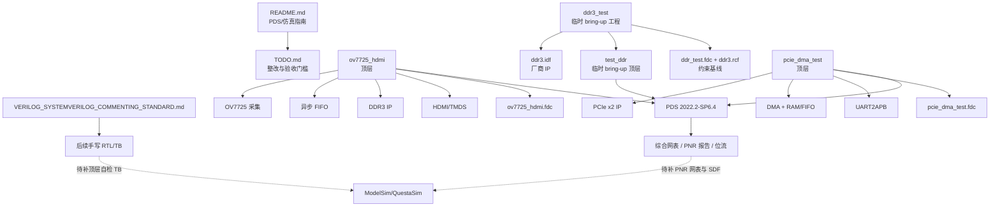

> generated_by: Codex manual bootstrap
> verified_at: 2026-08-29
> provenance: manual inspection of current source tree and PDS artifacts

# Dependencies

## 关键依赖约束

- 三工程的有效器件目标应与板卡实物一致；当前审计基线为 `Logos2 / PG2L100H / FBG484 / -6`。
- 厂商 `.idf`、生成 RTL 和 PDS 仿真库属于外部生成依赖，不应被误当作独立手写逻辑。
- OV7725 工程的摄像头、DDR UI 与 HDMI 时钟域互相依赖 CDC 和复位策略，必须先修结构再声明时序例外。
- DDR3 新入口已用 `test_ddr` 和 `ddr3.idf` 通过 compile-only；这只证明输入清单与编译入口可重复，不能替代完整实现、板级约束、产品自检或仿真验收。
- PCIe 顶层依赖专用 HSST/IP 约束；UART2APB 是否保留是后续 RTL 与 FDC 的共同决策点。
- 仿真流程依赖编译后的 Logos2 USIM/VSIM 库和可用的 `vsim.exe`/`vlog.exe`；当前环境不满足该依赖。
