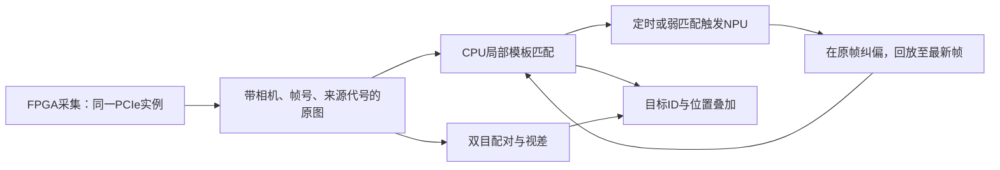

# TDM 识别、模板追踪与双目测距

TDM把NPU用于间歇识别和纠偏，把CPU模板匹配用于帧间位置更新。双目测距支持C1/C2、C5/C6两组独立配置，复用原采集线程与唯一PCIe句柄，距离可附在选中左相机的目标框上。默认启用模板追踪；双目必须显式启用，各组真实标定、同步参数与实物测试时机仍待提供。



## 使用

```sh
# 总NPU请求默认间隔250ms；多模型仍轮换，非每款各4Hz
./detview --rotate-model zebra-rk3568-raw-dfl6,wb_v4_combo \
  --detect-interval-ms 250 --detect-min-ms 100 --max-tracks 12

# 保留逐帧NPU检测，供后续实测对照
./detview --no-tracking --model zebra-rk3568-raw-dfl6

# 双目预览：LEFT_ID和RIGHT_ID必须替换为实际配对的1..6编号
./detview --stereo LEFT_ID,RIGHT_ID --stereo-scale 0.25 \
  --stereo-disparities 32 --stereo-interval-ms 200

# 确认标定、硬件曝光同步和共同帧号语义后才允许实物米数
./detview --stereo LEFT_ID,RIGHT_ID --stereo-calibration stereo.yml \
  --stereo-synchronized --stereo-tag-offset VERIFIED_LEFT_MINUS_RIGHT

# C1/C2与C5/C6两组预览，示例没有标定/同步确认，不输出有效米数
./detview --stereo-config stereo_pairs.example.json
```

单路显示由`--camera N`或V键选择。六宫格时，在首组左相机上识别和追踪；未启用双目时使用C1。选择C5时清空之前的追踪状态并在C5识别，目标深度使用C5/C6组。选择C2或C6时只预览对应组视差，不把左图深度移用于右图目标。单选其他相机时仍采集配置中的四路双目帧，当前只在**选中的一路**追踪，不跨相机融合ID。`--video`支持单路模板追踪，不能同时启用FPGA双目。

`--stereo-config`接收[JSON示例](stereo_pairs.example.json)，与旧单组相机/标定/同步参数互斥；支持1–2组且不重用相机。每组`left/right`为1–6编号，`calibration`相对JSON所在目录解析，`synchronized`为操作者确认，`tag_offset`为已核实的left_tag减right_tag；未填写偏移即不确认配对语义。`interval_ms`可设置100–5000ms，省略时沿用全局间隔。两组按准备情况轮询，完成一次计算后仍保留全局冷却，避免持续SGBM占用分析线程；全局间隔不是每组保证频率。缩放与视差范围共用全局参数，各组校正器、配对水位、过期与深度缓存独立。

## 监看与设置页面

默认进入监看页。顶栏显示运行状态、当前相机模式、模型简称与新画面率；底栏给出常用键。六路画面中只保留各路采集/画面率与检测框，青色边框标出用于识别的相机，参数和诊断文字集中到设置页。相机图像等比显示在顶栏与底栏之间，检测坐标随同一画面区域映射。

显示链路按新版camview改为每路连续RGB565帧直传和独立GPU纹理，正常运行不在CPU上拼接/拆分六路画面。按当前camview部署配置，默认单槽纹理且关闭垂直同步；`DETVIEW_TEXTURE_RING=1..3`可调纹理槽数，`DETVIEW_SWAP_INTERVAL=1`可恢复垂直同步以减少撕裂。HUD和设置文字仍在CPU位图上绘制以避免Mali字形花屏，再通过缓存GL纹理显示；HUD只更新和绘制实际覆盖区域。详见[显示同步说明](CAMVIEW_SYNC.md)；后续工作见[性能优化计划与TODO](TODO.md)。

按**Tab**切换监看/设置页；设置页按**Esc**返回监看，**G**从任何页面回到六路总览。**V**依次选择C1–C6和六路，视频源保持单路。进入设置页继续采集与识别；相机新画面率在该页不累计，返回时显示最新图像。按P才暂停。

设置页用**↑/↓**选择模型、画面、置信度阈值、轮换、框坐标格式或运行状态；用**←/→**调整，**Enter**切换。参数即时生效，模型列表展示当前模型及附近条目，左右键可访问全部模型。轮换时框坐标格式显示“按各模型配置”，不能覆盖各模型格式。识别策略、实时性能和设备状态各占独立区域。原1–9模型、R轮换、+/−阈值、C坐标格式、P暂停、S截屏、F全屏与Q退出快捷键仍可使用。

| 参数 | 默认 | 含义 |
| --- | --- | --- |
| --detect-interval-ms | 250 | 总NPU请求间隔，50–2000ms |
| --detect-min-ms | 100 | 现有目标失配/需要纠偏时最短请求间隔，不大于正常间隔 |
| --max-tracks | 12 | 所有轮换模型合计追踪上限，1–12，按模型分配 |
| --track-max-age-ms | 2000 | 距离最后一次NPU确认的追踪寿命，500–10000ms |
| --track-interval-ms | 33 | 车辆追踪处理间隔，0–200ms；0处理每个新帧，TTL仍按真实采集时间 |
| --track-template-side | 48 | 模板工作最长边，16–128；0用于无约束参考对照，输出框保持原图坐标 |
| --no-tracking | 关闭 | 开启后跳过模板匹配与检测限频；同一时刻仍仅一个待完成请求 |
| --stereo L,R | 不启用 | 左右两路编号，必须不同 |
| --stereo-config | 不启用 | 独立双组JSON，与旧单组相机/标定/同步参数互斥 |
| --stereo-scale | 0.25 | 视差处理比例，0.125–1 |
| --stereo-disparities | 32 | 处理图上视差范围，16的倍数且应小于图宽 |
| --stereo-interval-ms | 200 | 全局计算冷却与未单独指定组间隔的默认值，100–5000ms |
| --stereo-calibration | 空 | 完整双目标定，格式见[模板](stereo_demo/calibration.template.yml) |
| --stereo-synchronized | 关闭 | 操作者已确认硬件曝光同步 |
| --stereo-tag-offset | 不设置 | 同次曝光的left_tag减right_tag；独立自由计数不能靠填0建立同步 |

车道分割模型保持逐帧推理，不经过目标模板追踪。暂停、切相机、切模型、切换轮换、改变输出格式或置信度时会清空追踪/双目状态，并拒绝旧来源代号的推理结果。

## 模板追踪与调度

模板匹配仅用于车辆对象。按每个模型的类别语义选出车辆：当前混合模型的vehicle为cls1，单车辆模型为cls0；不统一写死类别编号。TT100K“机动车”等类别是交通标志，不参与车辆模板追踪。非车辆对象继续显示NPU检测框，没有追踪ID、模板预测或模板融合深度；有效期仍从原检测帧采集时间计算。

每个模型有独立的车辆追踪器。车辆NPU检测按同类IoU一对一关联已有目标，保持ID并更新模板；没有对应检测的旧轨迹删除。ID在进程内不复用，模板不能识别新类别或跨模型/跨摄像头融合身份。

追踪在灰度图上进行局部三尺度NCC匹配，搜索中心包含速度预测。大框采用局部工作图压缩与有界细校正，输出坐标仍是原640×480；`--track-template-side 0`保留无约束参考路径。拒绝恒定或弱纹理模板、低相似度和歧义峰，同类轨迹不能共同认领同一近乎重合的匹配观察。失配最多预测3个处理帧，随后删除并触发限频重检测；低追踪频率会改变这3帧的墙钟时长，但不能延长检测TTL。模板只在稳定高分匹配时缓慢更新。没有目标或无车辆类别的模型仍周期请求NPU，发现其他对象。

帧入口按相机只留2帧，回放历史最多8帧且不超过1秒，避免CPU或NPU慢时积压。每笔推理带来源代号、frameId与原采集时刻；找到对应原帧时在车辆快照上纠偏，再逐帧回放到最新帧。过旧或来源已切换的回复被丢弃。2秒未完成的推理预约会释放，晚到结果不能覆盖另一笔请求。

当前追踪按`--track-interval-ms`挑选最新帧处理，历史只记录处理帧；输入更快时跳过计数不代表传感器丢帧。源图被历史淘汰但回包仍在1秒源年龄以内时，保留原始NPU检测及原采集TTL，清旧车辆模板/深度，不对当前图强行纠偏。零追踪预算模型也保留原始检测框。来源变化或源年龄超过1秒的回复仍丢弃。存在较新入口不再阻止已处理快照发起NPU请求，避免连续输入导致请求饥饿。

显示也使用只保留最新画面的邮箱，合并尚未上传格子的changedMask；GUI慢时不会累计整幅图像队列。目标框携带NPU确认时刻确定的有效截止时间，停止采集后的渲染仍独立过滤过期框和米数。

默认的250ms相当于总计最多约4次/秒，弱跟踪时可提前到100ms；若轮换2款模型，正常每款约2次/秒，实际速度受推理和工作线程耗时影响。HUD显示实际请求率和模板匹配/回放耗时。减少NPU调用能释放算力，但新目标出现到识别的延迟会增加，快速运动、尺度突变、遮挡和相似物体仍可能丢失或换ID。

## 双目距离的有效条件

补采标定图可用`--calibration-capture --stereo-config stereo_pairs.example.json`。S保存当前组左右640×480原图并后台检查棋盘（6×9内角点，实测方格28.60mm）；总览默认C1/C2，选中C5或C6采C5/C6。D循环距离标签未知/0.5/1/2/4m，只在实测距离对应时设置；常规多姿态标定可保持未知。结果显示在顶栏，文件位于`/userdata/detview_calibration/C1_C2`或`C5_C6`，包含raw、角点图和capture.json。检测失败仍保存原始证据。此模式采集保持两组相机，但不执行车辆分析与双目计算。下载后运行`scripts/calibrate_stereo_raw.py --input DIR --pair C1_C2`，缺少足够多姿态或质量检验未过时只报告不足/草稿，不输出已验证参数。

必须具备640×480针孔双目标定、米制T、正确左右顺序、硬件曝光同步和共同曝光帧号对应关系，才输出米数。未满足时仅预览视差，HUD说明缺少的条件。同步开关是操作者确认，不会自动校准或同步相机。

配对只使用两路新帧，已确认共同帧号时要求对应计数一致，支持32位回绕。整帧和尾部16字节标签一次DMA读回，核对标签后才交付；标签仍不能排除未更新元数据时的写入，需要验证FPGA槽位发布协议。主机时间差不等于曝光时间差。

目标测距只在追踪框与左图frameId完全一致时计算，把框中央区域从原图通过标定映射到校正图，使用有效视差的中位Z。缓存仅300ms，目标移动过多或纠偏时丢弃；渲染层再次按采集时间隐藏过期数字。双目断流超过1秒清除旧距离HUD。中央ROI距离是该区域的光轴深度，不必然对应某个检测目标，也不是三维直线距离。

## 六路DMA与帧率口径

采集已同步当前运行camview的用户态DMA路径，继续使用原内核驱动和640×480 RGB565帧协议。六个线程共用一条DMA通道，每路拥有独立RX区，元数据使用独立scratch区；标签选择、整帧DMA和尾部标签核对在锁内完成，AArch64向量像素拷贝在锁外完成。每路同一时刻只有一笔读取，不会在自身拷贝结束前重用RX区。标签按最新乒乓槽去重，支持32位回绕。轮询间隔为6ms；显示提交默认16ms，计入快照处理耗时，可用`DETVIEW_MIN_MS`覆盖。

六宫格标签的`cap`是交付给应用的有效采集帧率，`new`是该路新帧实际提交纹理更新的帧率；主HUD的“新画面”每次绘制只计一次，即使六路同时变化。序号独立于强制刷新mask：切模式、刷新HUD或检测框不会把旧图再次算作新画面。新画面指标测量应用绘制，不等于屏幕扫描率，也不证明GPU已完成执行。

| 日志字段 | 统计事件 |
| --- | --- |
| delivered_fps | 每路通过尾部标签核对并交付的图像，5秒审计窗口 |
| tag_advance_rate | 两笔交付之间的标签增量除以审计时长，标签语义未经验证，不能直接当传感器fps |
| submit_fps | 有可见新内容的原始帧快照发布率；后台双目另一路更新不会单独触发发布 |
| take_fps | GUI消费最新显示邮箱的次数 |
| upload_new_fps | 纹理更新中至少有一个可见相机新序号的次数 |
| paint_new_fps | 绘制上述新内容的次数，多路变化只计一次 |
| paint_fps / paint_avg_ms | 全部绘制次数除以实际审计时长，以及单次平均绘制耗时，包含旧画面重绘 |
| npu_request_fps | 控制器实际提交到推理线程的请求数 |
| npu_started_fps / npu_completed_fps / npu_failed_fps | 推理线程开始、成功完成、执行失败的次数 |
| infer_service_ms | RKNN输入提交至输出释放的处理耗时，含运行、输出获取及解码，不含输入准备或等帧 |

HUD、GUI消费与NPU吞吐使用单调时间的一秒滑动计数窗；启动首秒仍用一秒分母，避免第一笔事件被放大成几百fps。无新事件一秒后归零。暂停恢复重置测量，保留采集帧号去重基线，并跳过暂停期间的标签增量。NPU完成在推理线程计数，再向GUI提供受锁保护的快照，避免GUI信号排队产生虚高值；轮换模型分别归零。“处理ms”与“完成fps”独立统计，不再用`1000/ms`冒充实际吞吐。

## 构建与离线验证

新增依赖OpenCV4的开发包和pkg-config，继续使用原Qt/RKNN/RGA环境：

```sh
qmake detview.pro INCLUDEPATH+=/path/to/rknn/include
make -j2
QT_QPA_PLATFORM=offscreen ./detview --vision-selftest
QT_QPA_PLATFORM=offscreen ./detview --tracker-benchmark
QT_QPA_PLATFORM=offscreen ./detview --dfl-selftest
QT_QPA_PLATFORM=offscreen ./detview --lane-selftest
QT_QPA_PLATFORM=offscreen ./detview --camera-dma-selftest
QT_QPA_PLATFORM=offscreen ./detview --frame-metrics-selftest
```

这些自测入口不启动采集、不打开PCIe、不加载RKNN模型。`--vision-selftest`验证模板核心、DMA区划/字节拷贝、刷新去重、计数帧率及双组融合调度。`--tracker-benchmark`使用固定种子，覆盖1/4/12目标与32×24、80×64、192×144框的9种合成场景，分别测update、深拷贝快照、检测纠偏及6帧回放。大框多目标场景画布超过640×480，只代表算法负载，不能代替真实单路性能或精度验收。验证结果见[验证记录](VISION_VALIDATION.md)。

显示统计默认开启，`DETVIEW_PERF=0`可关闭以对照计时开销。`[display-perf]`和`[display-events]`每5秒汇总实际窗口事件；`[display-stage]`输出各段墙钟平均、分位上界、最大值及溢出数。固定0.5ms桶的末桶从127.5ms开始，落在末桶的分位返回窗口最大值作为保守上界。GL调用时间包含等待，不是GPU执行时间；采集到上传年龄不是屏幕呈现延迟。设置页绘制单列，避免混入监看绘制。汇总工具为`scripts/analyze_display_perf.py`，只合并完整窗口计数和耗时，不平均各窗口分位数。

将示例中的include路径替换为实际包含`rknn_api.h`的SDK目录；已有构建目录中有该头文件时可以省略。开发验证使用板端现有SDK，不下载或安装运行依赖。

旧显示路径修复过六宫格合成stride问题；当前已直接传递每路拥有像素的连续RGB565帧，取消正常显示中的合成和拆格步骤，从路径上避免该stride误用。原PCIe驱动的全局状态和超时释放问题仍存在，运行时应保持设备独占。
