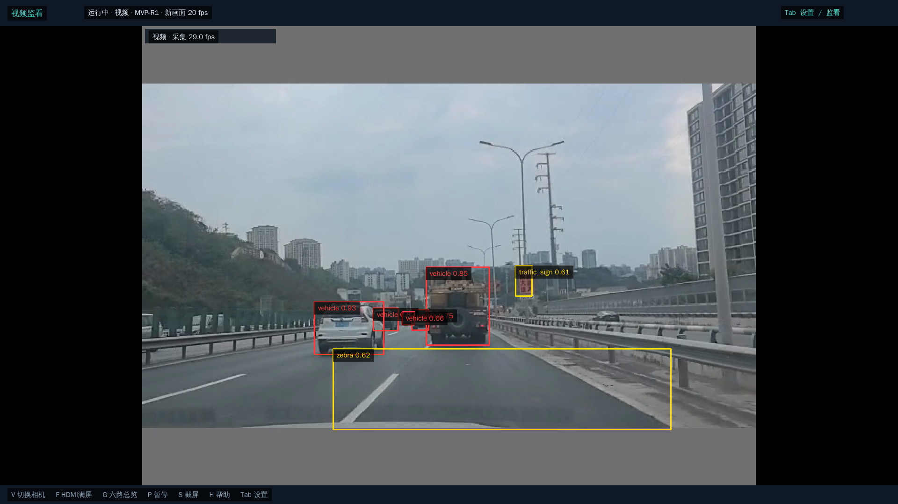
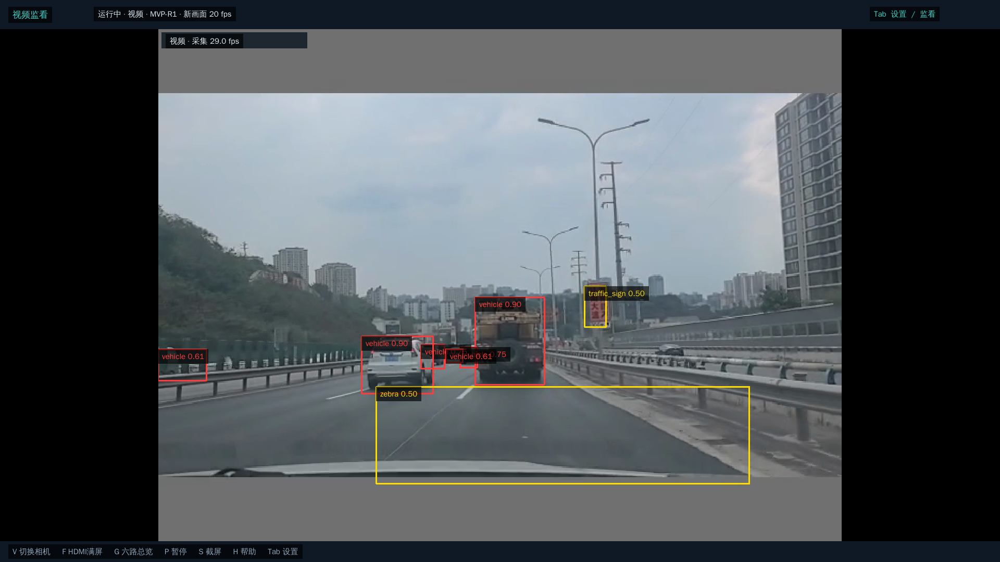

# 识别框防闪烁：板端安装记录

已在 RK3568 detview 显示端启用时序确认，当前 MVP-R1 道路视频循环预览使用新版本。

- 同类别、空间重叠的框连续出现在三次不同的推理结果中，才显示；单次和两次短暂出现会被隐藏。
- 已确认的框短暂漏检时保留最多 180ms。渲染端按到期时间自动隐藏，即使没有新推理结果也不会永久残留。
- 实际漏检并超过缓冲后，旧确认状态失效；重新出现仍须连续三次确认。
- 重复结果、画面重绘和跟踪预测不增加确认次数；模型、相机、来源及显示模式重置时清空历史。
- 低频跟踪模式的缓冲会覆盖其配置的推理间隔，并受原始画面有效期限制，避免按推理节拍重新闪烁。
- 新框在约 20FPS 推理时通常多等待约 100ms。只出现一两次的真实短暂目标也会被过滤；持续误检仍可能显示。
- 如果启用低频跟踪或模型轮换，三次确认的等待时间随该模型的实际推理间隔增加。

原始检测输出、新 MVP-R1 类别阈值/NMS、推理调度、车道点和跟踪/测距计算保持原路径，过滤只作用于显示副本。
候选框未显示的数量表示时序确认结果，不能当作有标注数据集上的误检数量或精度提升。

板端 30 秒行为检查记录 484 次 MVP-R1 推理、483 条完整识别框诊断，失败计数为 0。该短测包含全量 JSON 日志和截图，不用于判断帧率或卡顿；性能结论来自下面独立的预热后60秒统计窗口。

同视频、预热后60秒对照：旧版新视频帧 20.07FPS、推理 19.22FPS；最终过滤版新视频帧 20.52FPS、推理 18.63FPS。最终版最长推理完成间隔 106.38ms，超过250ms间隔 0次。推理间隔不是屏幕逐帧间隔；一次对照的小幅差异不能解释为统计显著变化。

通过时序算法测试以及 MVP-R1、旧 MVP、DFL、红绿灯、车道、HDMI 映射、vision 回归检查。本次验证不重新测数据集准确率。

当前预览 PID：6915。程序路径：`/userdata/detview-hdmifull/detview-hdmifull`。
源码：`/userdata/linaro/detview-temporal-work/`，活动源码已同步。
证据及回退备份：`/userdata/model_imports/detview_temporal_filter_20261007/`，包括 `detview.previous`、`source.previous/`、试验日志和截图。
显示端的新视频帧率与推理完成率分别统计；已有的最新帧替换机制仍可能跳过旧视频帧，未据此承诺每个30fps源视频帧都被显示。

可通过启动参数 `--no-temporal-filter` 临时关闭显示过滤，便于对照。
最终常驻预览关闭自动截图，避免截图占用显示线程。完整 A/B 性能证据见 `performance/` 目录；其截图在统计窗口之后保存。
全量识别框诊断仅用于短测，常驻预览不启用逐帧 JSON 日志，避免把诊断写入开销带进观看效果。

