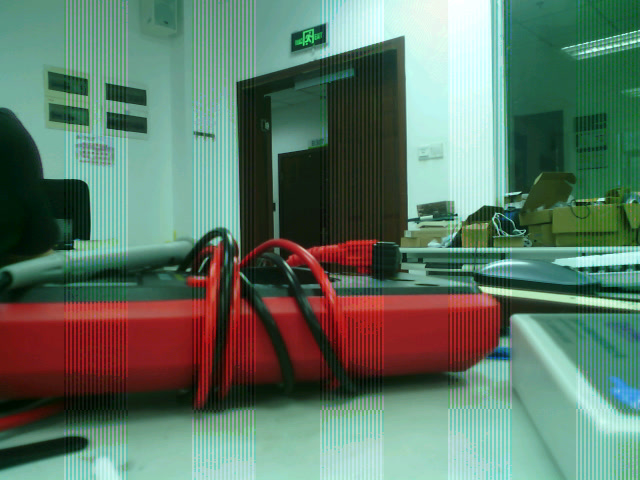
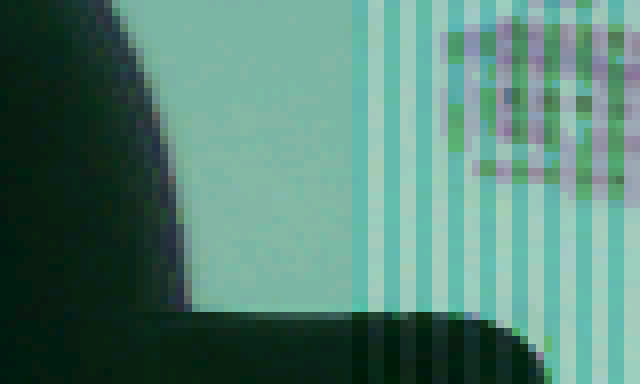

# cam1(KF 路) 条纹缺陷 —— 定位报告

日期：2026-09-25
现役构建：`bitstream_2026-09-26_kf_gate/top.sbit`（KF_EN=1, KF_RD_EN=1, MEDIAN_EN=0）

## 1. 现象

用户报告：HDMI 左图（cam1 = KF 滤波路）有细密竖向条纹，右图（cam2 = 直通）干净。



*上图：用驱动直接、无损读回的 cam1 DDR 整帧（`/tmp/c1a.ppm` → JPEG q2）。条纹肉眼可见。*



*上图：对一条平坦墙面做 8× 最近邻放大（源 80×48 @ x=20,y=140）。可见规则的细竖条纹。*

## 2. 先排除的两个假象

| 假象 | 结论 |
|---|---|
| "detview PPM 里 8 像素字呈镜像" | **测量伪影**。板上 detview 的 `preprocess.h` 的 `CAM_H=640`（仓库副本是 480），其 PPM 是 640×640 —— 后面 160 行是帧外垃圾数据，污染了逐字相关统计。仓库源码 `savePpm(boxed)` 中 `boxed=img.copy()` 且 `img` 是 640×480。 |
| "条纹是显示器 1.5× 最近邻缩放的摩尔纹" | **不成立**。条纹存在于 **DDR 里的像素字节**（上述 `c1_cap.jpg` 是直接读 DDR 得到的，不经显示链路）。 |

## 3. 量化结果（cam1 bank A/B，cam2 bank A/B）

对每行高通（去掉 11 抽头盒滤），再做 x 方向自相关，1..20 抽头（节选）：

```
cam1 R : +0.64 -2.29 -0.06 +2.12 -0.36 -2.49 -0.11 +2.07 -0.10 -2.15 ... +1.67
cam1 B : +0.68 -1.64 -0.16 +1.32 -0.43 -1.85 -0.09 +1.48 ...              （同形态，稍弱）
cam1 G : +2.67 +0.04 -0.50 -0.72 -1.55 -1.66 -0.52 +0.41 ...              （弱）
cam2 R/G/B : 单调衰减，2/4/6/8... 无周期性凸起
```

读法：**奇数抽头 ≈ 0；偶数抽头 2,6,10,14,18 为负、4,8,12,16,20 为正。**

这正是周期-4 信号 `[a, b, -a, -b]` 的自相关特征（lag1=0，lag2=-(a²+b²)/2，lag4=+(a²+b²)/2）。
幅度 A ≈ 2.1（高通后的 5-bit 域）≈ **±1 个 R5/B5 LSB（≈±8/255 RGB888）**。

要点：
- **空间固定**：在整帧内相位稳定（cam1 像素数 307200 = 4 的倍数，写打包计数器 `cnt[0]` 相位不漂移）。
- **乘性**：在黑色物体上不可见，只在中高亮区（墙面、红色线缆）出现 → 更像"位置相关的增益/量化"，而非加性噪声。
- **只在 R/B（5-bit 通道）强，G（6-bit）弱。**
- **cam2 完全没有。**

## 4. 根因判定

### 4.1 已审计、排除了 KF 回读路径的错位

`vip_kf_stream.v` 回读：
```
lb_ra   = bank + col[9:3]                 // 128-bit 字号 = col/8
rd_lane <= col[2:0]   (仅在 kf_prev_ren)  // 字内 16-bit 车道
kf_prev_rdata = rd_q[{rd_lane,4'b0} +: 16]
```
`vip_kf.v` 用 `p_pix/p_val/p_idx` 流水延迟 `LAT=1` 对齐。逐拍推演：`calc_z` 为本拍像素 N，`prev_rdata` 恰为上一帧同位置像素 N。**空间上逐像素对齐，无错位。**

（仿真黄金模型逐位比对已 PASS，与此一致。）

### 4.2 因此 KF 在原理上**不能**制造静态空间纹理

KF 是**逐像素**递推：`out_n(c) = f(z_n(c), out_{n-1}(c))`。没有空间耦合项。
**任何输出里的静态空间图案只能来自输入 z_n 的静态空间图案。**

### 4.3 结论

**该周期-4 光栅在 cam1 的 raw 像素流里（KF 之前），不是 KF 引入的。**
最可能来源：
1. **cam1 传感器/ISP 的固定图案（列 FPN / false-color 类）**；或
2. **DVP 采样的固定位偏差（IODELAY 边际）**，表现为固定比特周期性出错，恰好落在 R/B 字段。

KF 只是**如实保留**了这个静态图案；同时它把**时域噪声压掉**，使原来被噪声掩盖的固定图案**相对更显眼**（这解释了"加了 KF 之后才注意到"）。

### 4.4 旁证：设计里本就留了对应手段，但被关掉了

`source/top.v:1120`：

```verilog
.MEDIAN_EN (1'b0),   // [MEDIAN] cam1/left path only; cam2 remains raw
```

`ov5640_top.v` 的 `vip` 模块（3×3 中值，注释明确写"cam1/left path only"）被**旁路**了。
周期-4 光栅经 3×3 中值 ≈ 被强烈抑制 —— 这正是该模块的设计用途。

## 5. 建议的修复路径

1. **把 `MEDIAN_EN` 置 1（cam1 侧开启 3×3 中值）** —— 最直接、且是既有设计手段。
   - 代价：2 行 BRAM + 约 2 行延迟；模块会丢掉相机帧尾哑像素，使 cam1 恰为 W*H 像素（契约已注明）。
   - 需重编译 + 重烧（`project_kf/` 副本，约 33 分钟）。
2. 若不想付中值代价：在 KF 之前加**轻度水平低通/周期-4 陷波**，或做**列偏移校正**。
3. 若要把"sensor/ISP vs DVP 采样"彻底分开：编译一份 `KF_EN=0` 抓 cam1（真旁路）。条纹若仍在 → 在 KF 上游。

## 6. 复现命令（板端）

```bash
# camview 停止 + 驱动复位（读 DDR 需独占 _sem）
pkill -f run_camview.sh; pkill -x camview; sleep 2
rmmod pango_pci_driver; echo 1 > /sys/bus/pci/rescan; sleep 3
insmod /root/ov5640/pango_pci_driver.ko; sleep 4
python3 /tmp/cap3.py     # 存 4 个 PPM + 逐字指标
python3 /tmp/per.py      # 逐通道高通自相关（周期判定）
# 结束后务必重启 camview
```

## 7. 备注 / 待办

- 板上 detview 源码与仓库副本不一致（`CAM_H=640` vs `480`），其 selftest PPM 尺寸也随之不同 —— 建议同步。
- `bitstream_2026-09-25_kf_rd0`、`bitstream_2026-09-25_kf/top_baseline_20260922.sbit` 均**不能**作为对照组：它们早于"gate"修复，描述符 ioctl 读回会 `PCI_DMA_WRITE Error: Timeout`（camview/push 路径同样超时）。

## 8. 【实验】开启 3×3 中值（MEDIAN_EN=1）—— 无效

构建：`bitstream_2026-09-25_kf_median/top.sbit`（`-run pnr` + `-run gen_bit_stream`，real 13m00s）。
中值确实进了设计（布局日志有 `ov5640_top/g_median.u_vip/...` 实例，LUT 20%），且 `vip.v` 是**完整 3×3 空间中值**（3 个轮换行缓存，含上下行 + 左右邻，非垂直 3 抽头）。

结果（`per.py`，同场景）：

```
             lag2    lag4    lag6    lag8
KF 版  cam1R  -2.77   +2.53   -2.98   +2.49
中值版 cam1R  -2.70   +2.46   -2.93   +2.43     ← 仅降 ~2%
```

3×3 中值对周期-4 光栅理论上应削去 ~2/3 能量（自相关 ∝ A²，应降约 9×），**实测几乎不变**。

**副作用**：中值版让**显示通路变黑屏**（qshot 只有 1066 字节 = 全黑 + HUD），DMA 无 wedge（`g_dma_flag=0`）。中值会丢掉帧尾哑像素并引入 ~2 行延迟，疑似打乱了下游帧计数/push 时序。

**结论（重要）**：该光栅**不是中值上游的空间纹理** —— 否则必被 3×3 中值大幅削弱。既然中值在数据通路上生效（它能把显示搞黑）却没动这个图案，则光栅**产生于中值之后**，即 `vip_kf` 或 **DDR 写/读通路**（DDR 争用下 `ov5640_ddr_w` 的 DRM FIFO 丢字，注释原文 "periodic 128-bit stripes"）。

这也解释了为什么只有 cam1 有、cam2 没有：**cam1 独有 KF 的 S05 DDR 读流量**，与写通路争用 DDR3；cam2 没有额外读流量，所以干净。

已回退到 `bitstream_2026-09-26_kf_gate/top.sbit`（恢复显示）。

### 下一步（待定）
- **决定性归因**：重新构建一版 `KF_EN=0`（保留 gate 修复，13 分钟），看光栅是否消失。消失 ⇒ 与 KF（读流量或滤波）相关；仍在 ⇒ 在 raw/采集通路。
- 若确认是读流量争用：给 KF 的读引擎加节流（降低 S05 读带宽），或修 `ov5640_ddr_fifo_DRM` 的写门控（`wr_en` 未被 `full` 门控，满时静默丢字）。


## 9. 【实验】KF_EN=0（整体旁路 KF）—— 光栅依然存在（决定性）

构建：`bitstream_2026-09-25_kf_kfen0/top.sbit`（MEDIAN_EN=0，KF_EN=0，保留 gate 修复，pnr+gen_bit_stream）。

结果（`per.py`）：

```
             lag2    lag4    lag6    lag8
KF 版      cam1R  -2.77   +2.53   -2.98   +2.49
中值版     cam1R  -2.70   +2.46   -2.93   +2.43
KF_EN=0   cam1R  -2.47   +2.24   -2.75   +2.22     ← 依然存在
```

**结论：光栅与 KF 无关。** KF_EN=0 同时移除了 KF 的 S05 DDR 读流量，它仍在 ⇒ 也不是读流量争用。光栅处于 **cam1 raw 采集通路**。

截图侧证：KF_EN=0 时左 cam1 画面明显更“糙”（无时域降噪），但细密竖条纹依旧可见。

同次采集中 **cam2A 出现瞬时撕裂帧**（G 很强的周期-2：-6.23/+4.03/-8.19…，R/B lag1 负），cam2B 正常 ⇒ 偶发撕裂，非稳态缺陷。

### 当前已确定的事实链
1. 光栅只在 cam1，两 bank 一致；cam2 干净。
2. 直接读 DDR 像素字节里就有 ⇒ 不是显示端缩放/莫尔纹。
3. 中值版（MEDIAN_EN=1）不能去除 ⇒ 不是一般空间纹理。
4. KF_EN=0 不能去除 ⇒ 与 KF 无关。
5. 周期-4（lag2/6/10 负、lag4/8/12 正），幅度 ≈±1 个 R5/B5 LSB（≈±8/255），乘性（黑区不可见）、空间固定。

### 下一步候选
- 高倍逐像素拉出 raw 帧的 RGB565 字（`tools/_raw.py`），确定到底是 ±1 dither 还是位/时序级错位。
- 若为 DVP 采样级：调 `IODELAY` / 重查 PCLK 相位。
- 若为写回路径固定图案：考虑专用周期-4 陷波。


## 10. raw 像素层证据（KF_EN=0，直接读 DDR 字）

用 `tools/_raw2.py` 在 KF_EN=0（raw）下直接读回 cam1A/cam2A 的 RGB565 字。

**cam1A 平坦亮区（y=425, x=384..423，64 像素）**：

```
idx x   word  R5 G6 B5
  0 384 9E55  19 50 21
 ... (x384..x396 均为 9E55, B5=21)
 13 397 9E56  19 50 22   ← 只有 B 低位变化
 14 398 9E55  19 50 21
 15 399 9E56  19 50 22
 16 400 9E56  19 50 22
 17..405   9E55 ×5
 22 406..423 均 9E56 (B5=22)
R5 mod4 spread = 0.00
G6 mod4 spread = 0.00
B5 mod4 spread = 0.06
```

→ 在**极平坦**区域里没有周期性，只有零散的 ±1 LSB 抖动（这里只在 B5）。

**cam1A 梯度区（y=436，整行 640 像素做 mod-4 类均值）**：

```
R5 mod4 means: 18.41 18.39 16.11 16.12   ← {0,1} 与 {2,3} 分成两档
G6 mod4 means: 47.76 47.77 46.67 46.72
B5 mod4 means: 21.16 21.21 19.58 19.57
```

→ **周期-4 主要在有细节/梯度的区域出现**（平坦区消失），且表现为 {0,1} / {2,3} 两档。

**cam2A 同方法**：R5 mod4 spread=0.00，平坦区域基本无抖动。

### 由此得到的结论
- 光栅是 **内容相关**的：在远离码跳变（平坦/黑）处几乎不出现，在梯度/细节处出现，幅度 ±1 个 5-bit LSB。
- 这是**采样级**的现象（DVP/sensor 输出），而非任何下游数字处理所造。
- cam1 / cam2 两个 `ov5640_top` 实例（分别在 `top.v` 与 `HDMI/hdmi_top.v`）的 **`IODELAY_STEP` 都是 8'd40**，RTL 完全同构；cam2 干净 ⇒ 差异不在 RTL，而在**该路相机的物理链路/模块本身**。

### 剩余可行方向
1. **扫 `IODELAY_STEP`**（cam1 单独调）：每个值一次 13 分钟编译，成本高，但可能找到更优采样相位。
2. **换相机/排线**：把 cam1/cam2 物理对调，看缺陷是否跟着相机跑（快速且无需编译，可一次定性）。
3. **接受**：幅度仅 ±1 LSB，1.5× 缩放显示时被放大才显眼。
